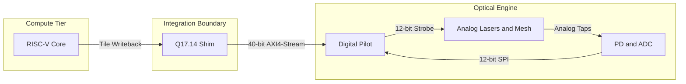

# Level 0 — System Context

The whole fabric in one screen: five blocks and the signals between them. Every
Level 1 document zooms into one of these arrows.

## Block notes

| Block | What it is | Owned by |
|-------|-----------|----------|
| RISC-V Core | Vortex 3.0 / Ten-Four compute unit; emits a resolved partial-sum tile at each MMA tile boundary | upstream (vendored, not a `gcb-*` repo) |
| Q17.14 Shim | Converts the fp32 / int32 accumulator word to fixed point and drives the streaming bus | `gcb-rtl/integration/` |
| Digital Pilot | Deterministic FPGA controller — buffer-halt sync, block-floating-point normalization, DAC/ADC sequencing, ratiometric reconstruction | `gcb-rtl/rtl/` |
| Analog Lasers and Mesh | Modulated O-band sources into an 8x8 unitary mesh; physical superposition performs the sum | `gcb-spec/` (bench parameters), Phase II integrated cell |
| PD and ADC | Two detection taps — reference and result — digitized on a common clock | `gcb-rtl/rtl/` (interfaces), `gcb-spec/` (bench parts) |

## Reconciliation with the spec repos

This diagram simplifies for readability; the binding definitions are in
`gcb-spec`:

- **"40-bit AXI4-Stream"** is a conceptual bundle. Per
  `gcb-spec/carry_save_streaming_contract.md` §6.1 the payload `TDATA` is a
  **32-bit** Q17.14 word; the remaining bits are framing sideband
  (`TLAST`, `TID`, `TUSER` = `{nan_inf, clamp, cell_lane}`, `TKEEP`).
- **"12-bit Strobe"** is the pilot's per-lane DAC drive after the
  block-floating-point pass (`greencoyote_photonic_sequencer.sv`); the
  precision-mode packing (INT4 / FP4 / FP8 / BF16) is selected by
  `PRECISION_MODE.MODE_SEL`.
- **"Analog Taps"** — Tap 0 is the reference (total input power), Tap K is the
  weighted carry-save result; the cell output is `ADC_TapK / ADC_Tap0`, which
  cancels global insertion loss (the Analog-ECC / ratiometric readout).
- **"12-bit SPI"** is the SPI SAR ADC master in `greencoyote_adc_if.sv`.

## Drill-downs

- [`01_streaming_sequence.md`](01_streaming_sequence.md) — the Core → Shim →
  Pilot → Optics → ADC path for one reduction.
- *(planned)* `02_buffer_halt_state.md` — the pilot's firing sequencer state
  machine.
- *(planned)* `03_calibration_flow.md` — the MDL / tap-balance calibration
  against the pilot registers.
