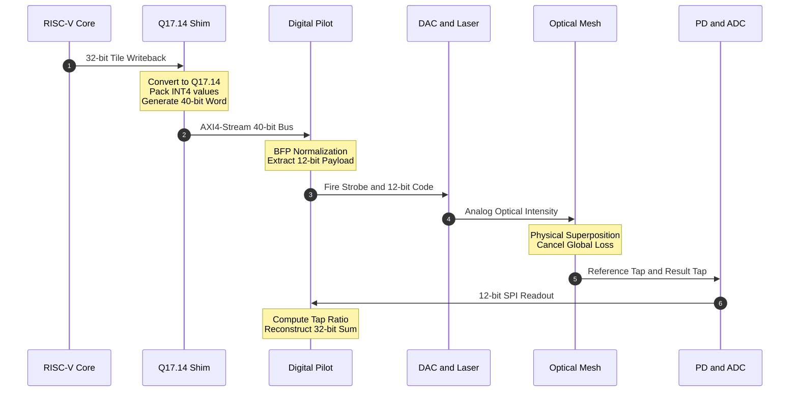

# Level 1 — Streaming Sequence

One reduction, end to end: the operational boundary from a RISC-V tile writeback
to a reconstructed 32-bit sum. Drills into the `Core --> Shim --> Pilot` and
`Pilot --> Optics --> ADC --> Pilot` arrows of
[`00_system_context.md`](00_system_context.md).

## Step notes

| # | Step | Detail | Source of truth |
|---|------|--------|-----------------|
| 1 | Tile writeback | `VX_tcu_core.result_if` at the MMA tile boundary — one resolved 32-bit word per lane (fp32, or int32 for INT8/INT4 modes) | `gcb-spec/vortex_integration_notes.md` §3–§4 |
| 2 | Convert | fp32/int32 → Q17.14 two's-complement, rne rounding, saturation, `nan`/`clamp` flags | `gcb-rtl/integration/VX_tcu_q1714_convert_pkg.sv` |
| 3 | Stream | one `M_AXIS_CS` beat per lane, `TLAST` on the last lane of a record | `gcb-spec/carry_save_streaming_contract.md` §6 |
| 4 | Normalize | per-reduction block-floating-point pass — shared block exponent from the lane maxima, offset-binary bias | contract §5 |
| 5 | Fire | `dac_sync` strobe + per-lane 12-bit code to the DAC PHY | `greencoyote_photonic_sequencer.sv` |
| 6 | Modulate | 8-bit-linear intensity modulation of the O-band sources | `gcb-spec/bench_emulation_parameters.md` |
| 7 | Sum | photon superposition through the 8x8 unitary mesh | `gcb-papers/p1-cascaded-reduction/` |
| 8 | Detect | Tap 0 (reference) and Tap K (result) onto two matched PD + TIA chains | `gcb-spec/task3_physical_bom.md` §3 |
| 9 | Digitize | SPI SAR ADC master, both taps on a common clock | `greencoyote_adc_if.sv` |
| 10 | Reconstruct | `ADC_TapK / ADC_Tap0`, de-bias by the lane count, re-scale by the block exponent → 32-bit Q17.14 sum, forwarded to the next cascade stage or the fabric output | contract §5.3–§5.4 |

## Reconciliation with the spec repos

The diagram compresses a few things for readability:

- **"Pack INT4 values" / "40-bit Word"** — the shim's job is the Q17.14
  conversion and the AXI4-Stream framing; `TDATA` is **32-bit**. Precision-mode
  packing (INT4 / FP4 / FP8 / BF16 into the 12-bit DAC window) is nominally the
  **pilot's** `dac_packed` logic driven by `PRECISION_MODE.MODE_SEL`, shown at
  the boundary here only for brevity. "40-bit" = 32-bit payload + framing
  sideband.
- **"Extract 12-bit Payload"** is the block-floating-point mantissa window
  (`SAT_GUARD` above, `NOISE_HEADROOM` below), one shared exponent per reduction
  cell — carried digitally, out of band, never across the optical link.
- **"Cancel Global Loss"** — the ratio `ADC_TapK / ADC_Tap0` cancels any loss
  common to both taps; the residual that does *not* cancel is per-tap
  Mode-Dependent Loss, which the pilot calibrates via `CH_GAIN_TRIM`.
- A tile writeback fires once per MMA uop; only the **last-K** writeback per
  sub-tile is streamed (`VX_tcu_tilefinal_tag.sv`, contract §9).
