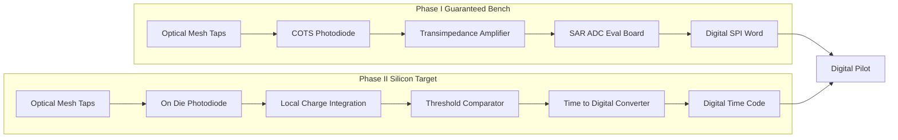

# Level 1 — Receiver Architecture

Drills into the `Optics --> ADC --> Pilot` arrow of
[`00_system_context.md`](00_system_context.md): how the two optical detection
taps become digital, in Phase I and in Phase II.

## Architectural invariant — no routed analog voltage

> **No routed analog voltage signals. Analog nodes must remain physically local
> to the receiver cell and must not cross the electrical interconnect fabric.**

Analog voltage is fragile the moment it leaves its source: it picks up ground
noise, crosstalk, and IR drop over any routed distance, and every millimetre of
interconnect adds an error term the calibration cannot see. The rule is that the
signal is **digital before it is routed**. Whatever analog processing a tap needs
— transimpedance, integration, comparison — happens inside the receiver cell;
only a digital word leaves it.

This is the receiver-side counterpart of the digital-boundary discipline the
pilot already enforces (`gcb-spec/carry_save_streaming_contract.md`): the optical
link carries light, the receiver emits bits, and nothing in between is a routed
analog node.

## Two-path strategy

### Phase I — Guaranteed Bench (COTS)

Photodiode → transimpedance amplifier → SAR ADC, all COTS, per
`gcb-spec/task3_physical_bom.md` §3 and `greencoyote_adc_if.sv`.

- **Purpose:** prove the optical-summation and ratiometric-cancellation physics
  — that `ADC_TapK / ADC_Tap0` cancels global insertion loss and that per-tap
  Mode-Dependent Loss is calibratable — at a **target ≈ 10.8-bit ENOB**
  (the clean ratiometric model shows ≈ 10.3-bit RMS; D3 measures the delivered
  value).
- **Invariant compliance:** the analog voltage node — the TIA output, ~1.5 V
  full scale — exists, but it is confined to the receiver eval board. The ADC
  digitizes it *there*; only the **digital SPI word** crosses to the pilot. No
  analog voltage is routed across the interconnect fabric.
- **Why COTS first:** the summation and cancellation physics are what Phase I
  must de-risk. A guaranteed, well-characterized PD → TIA → ADC chain removes
  the receiver as a variable so the measurement isolates the optics.

### Phase II — Silicon Target (local integration + TDC)

On-die photodiode → local charge integration → threshold comparator →
Time-to-Digital Converter. Output is a **digital time code**.

- **Purpose:** eliminate chip-level analog voltage routing entirely. The PD
  current charges a small local capacitor; a comparator trips at a fixed
  threshold; an on-die TDC measures the trip time. Integration time is inversely
  proportional to photocurrent, so the time code is a direct digital measure of
  optical power.
- **Invariant compliance:** there is **no analog voltage node to route**. The
  integrator and comparator are the only analog elements and they sit inside the
  receiver cell; the TDC output is digital at the cell boundary. TIA and ADC —
  and their analog interconnect — are removed.
- **Ratiometric readout:** becomes a ratio (or logarithmic difference) of two
  TDC counts — reference tap vs. result tap — computed in the pilot exactly as
  the Phase I ADC ratio is. The contract (`§5`) is unchanged; only the
  quantization primitive changes.
- **Open items for Phase II:** TDC resolution vs. the ≈ 10.8-bit target;
  integrator reset / dead-time budget; comparator offset and its calibration
  (maps to the same `CH_GAIN_TRIM` / `GLOBAL_CAL` path); linearity of
  charge-time vs. photocurrent across the dynamic range.

## Datapath comparison

| | Phase I bench | Phase II silicon |
|--|---------------|------------------|
| Quantization primitive | SAR ADC voltage sample | TDC of charge-integration time |
| Analog node | TIA output, on the eval board | integrator + comparator, inside the cell |
| Routed off the receiver | digital SPI word | digital time code |
| Analog interconnect | none across the fabric | none — TIA/ADC removed |
| ENOB | target ≈ 10.8 bit (D3-measured) | target ≈ 10.8 bit (TDC-resolution-limited) |
| Ratiometric readout | `ADC_TapK / ADC_Tap0` | `TDC_TapK / TDC_Tap0` |

## Related

- [`00_system_context.md`](00_system_context.md) — where the receiver sits.
- [`01_streaming_sequence.md`](01_streaming_sequence.md) — steps 8–10, detect →
  digitize → reconstruct.
- `gcb-spec/carry_save_streaming_contract.md` §5 — the reconstruction math both
  paths feed.
- `gcb-rtl/rtl/greencoyote_adc_if.sv` — the Phase I SPI SAR ADC master.
