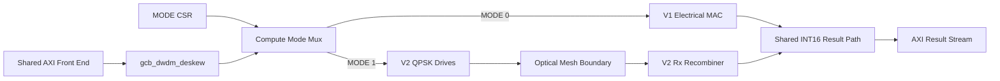

# Level 1 — Dual-Mode Integration

Drills into the digital top-level that carries **both** compute lineages at
once: the proven V1.0 electrical MAC (`gcb-wdm-transceiver`) and the V2.0
photonic QAM datapath (`gcb-photonic-qam-v2`), selected at runtime by a CSR.
Builds on the receiver split in
[`02_receiver_architecture.md`](02_receiver_architecture.md) and the tiling
constraint in `gcb-photonic-qam-v2/intent.md`.

Source: the Grok architectural review. Its recommendation, in four points —
the V1.0 electrical MAC stays the golden fallback; the V2.0 photonic QAM
datapath sits beside it; a single CSR bit selects the active compute mode;
the architecture unifies strictly on `K_MAX = 16` to stay inside the ≈ 30 dB
SNR optical budget.

> **Dual-Mode invariant. The production digital top-level instantiates the V1.0
> electrical MAC and the V2.0 photonic QAM datapath side by side. A CSR field
> selects exactly one active compute mode; transport, deskew, CSR, and the AXI
> boundary are shared. Reset default is V1.0.**

## 1. The Fallback Doctrine

The legacy V1.0 transceiver is not discarded. Its AXI shell, elastic deskew
FIFOs, and DWDM transport logic are silicon-proven, and its electrical INT16
MAC array is already the digital golden reference for the V2.0
numerical-error model (`gcb-photonic-qam-v2/intent.md`, Invariant #2). The
final digital top-level therefore wraps two interchangeable compute cores
behind one transport / AXI front end.

| | V1.0 — Electrical MAC | V2.0 — Photonic QAM Datapath |
|--|----------------------|------------------------------|
| Source repo | `gcb-wdm-transceiver` | `gcb-photonic-qam-v2` |
| Compute | standard-cell INT16 multiply-accumulate | balanced-homodyne optical cross-products, digital recombine |
| Physical risk | none — all electrical, characterised | analog + photonic blocks not yet silicon-characterised |
| `MODE` CSR | `0` — reset default | `1` |

- A **Control/Status Register** field (`MODE`) selects the live core. An
  unconfigured device is always in the known-good electrical mode.
- Only the selected core is clocked and driven; the other is held quiescent.
  The AXI-Stream operand / result ports, the deskew FIFOs, and the CSR block
  are shared single instances.
- Mode selection is a control-plane action — quiesce, write `MODE`, resume —
  not a per-beat choice.

> **Why this de-risks tape-out.** The electro-optic path depends on
> `gcb-analog-rx` and `gcb-pic-core`, whose silicon behaviour is still
> unproven. Carrying V1.0 on the same die turns a photonic SNR or yield
> shortfall into a performance regression instead of a dead part.

## 2. $K_{MAX}$ Unification

Both lineages independently land on the same contraction bound:

- **V1.0** already fixes it structurally —
  `gcb-wdm-transceiver/rtl/gcb_dwdm_pkg.sv`: `localparam int K_MAX = 16`
  (max reduction depth of the deskew + MAC pipeline).
- **V2.0** derives $K \le 16$ from physics — the balanced-homodyne SNR
  requirement grows by ≈ +3 dB per doubling of $K$ (DPI-C co-simulation,
  `gcb-photonic-qam-v2/model/RESULTS.md` S3). $K = 16$ fits a realistic
  ≈ 30 dB integrated-MZI budget; $K = 64$ would need ≈ 36 dB.

The unified architecture **strictly enforces `K_MAX = 16`**:

- one shared `K_MAX = 16` parameter feeds both cores and the CSR `K_LEN`
  range check;
- the host tiler (`gcb-python-orchestrator/scheduler.py`, `K_MAX_HW = 16`)
  chunks every contraction to $K \le 16$ and accumulates the INT16 partials
  digitally, in **either** mode;
- `K_LEN > 16` is a software error in both modes — the hardware does not
  clamp it.

The alignment is a real convenience: one tiling schedule and one
partial-accumulation path serve both compute modes unchanged.

## 3. Interface Ownership

Transport and dispersion handling stay with V1.0; only the compute boundary
forks by mode.

### Retained by V1.0

- **`gcb_dwdm_deskew`** keeps sole ownership of **chromatic-dispersion
  elasticity** — the per-wavelength elastic FIFOs that realign DWDM lanes
  skewed by fibre dispersion. Both compute modes receive already-deskewed,
  lane-aligned operands from it.
- `gcb_dwdm_ctrl_axi` (the CSR block), the AXI-Stream operand / result
  plumbing, and DWDM framing remain V1.0-owned.

### Compute boundary — mode-dependent

| Mode | Boundary | Payload |
|--|----------|---------|
| V1.0 | `color_word_t` (`gcb_dwdm_pkg.sv`) | packed legacy colour word into the electrical MAC |
| V2.0 | raw QPSK drives | per-lane $\pm 1$ / $0$ bit-plane drives — two colours × I/Q (`a_c0_i`, `a_c0_q`, `a_c1_i`, `a_c1_q` and the B-side equivalents) straight to the optical mesh |

- The optical boundary **exposes the raw $\pm 1$ QPSK drives directly** — no
  positional weighting in the analog domain
  (`gcb-photonic-qam-v2/intent.md`, Invariant #1). Positional recombination
  is digital, in the V2.0 Rx recombiner.
- The legacy `color_word_t` boundary is **kept intact alongside it**; V1.0
  consumes it unchanged when `MODE = 0`.
- Downstream of compute the modes converge again: the recombined /
  accumulated INT16 result re-enters the shared V1.0 result path.

## Top-level shape

## Related

- [`00_system_context.md`](00_system_context.md) — the five-block fabric view.
- [`02_receiver_architecture.md`](02_receiver_architecture.md) — Phase I / II
  receiver datapath and the no-routed-analog-voltage invariant.
- `intent.md` — the Electro-Optic Triad repo split (Components 1–3, 6 digital;
  5 analog; 4 photonic).
- `gcb-photonic-qam-v2/intent.md` — Software Tiling Constraint, Invariants #1
  and #6.
- `gcb-wdm-transceiver/rtl/gcb_dwdm_pkg.sv` — V1.0 `K_MAX`, `color_word_t`.
