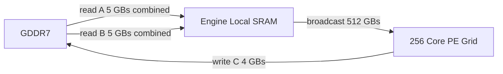

# Level 1 — Photonic Memory Dataflow

Quantitative dataflow model for the Photonic Tensor Complex against a shared
GDDR7 fabric, in the heterogeneous Vortex + Photonic system described in
`goal.md` ("Memory Architecture Doctrine"). Answers, in exact bytes and clock
cycles, what GDDR7 bandwidth and what Engine-Local SRAM capacity keep 256
K=16 optical cores at 100% utilization for a reference 4096x4096 INT4 matmul.
**No RTL for the memory dispatcher is written until the numbers below are
settled** — this document is that gate.

> **Result.** A weight-stationary SRAM tile of B sized `N_tile = 1024`
> (2 MiB single-buffered, **4 MiB double-buffered**) needs only **9 GB/s**
> sustained GDDR7 bandwidth (5 GB/s read, 4 GB/s write) — **4.5 bytes per
> clock at 2 GHz** — to hold all 256 cores at 100% utilization. That is
> roughly 1/14 of one GDDR7 device's per-pin bandwidth and orders of
> magnitude under any realistic multi-device subsystem. This workload is deep
> in the compute-bound region of the roofline; SRAM capacity, not GDDR7
> bandwidth, is the binding constraint.

## 1. Target Operation and Hardware Baseline

| given | value |
|---|---|
| Operation | $C = A \times B$, $A, B \in \mathbb{Z}^{4096\times4096}$ |
| Operand precision | INT4 (A, B) |
| Accumulation precision | INT16 (C) |
| Optical clock | 2 GHz (0.5 ns / cycle) |
| Optical core array | 256 parallel $K{=}16$ cores, 1 dot-product/core/cycle |

## 2. Compute-Bound Cycle Count

Total MACs for the reference GEMM:

$$4096 \times 4096 \times 4096 = 4096^3 = 2^{36} = 68{,}719{,}476{,}736 \text{ MACs}$$

Each core retires one $K{=}16$ dot product (16 MACs) per cycle; 256 cores in
parallel retire $256 \times 16 = 4096$ MACs/cycle:

$$\text{cycles} = \frac{2^{36}}{4096} = \frac{2^{36}}{2^{12}} = 2^{24} = 16{,}777{,}216 \text{ cycles}$$

$$\text{time} = 2^{24} \times 0.5\,\text{ns} = 2^{23}\,\text{ns} = 8{,}388{,}608\,\text{ns} = \mathbf{8.388608\ ms}$$

Sustained MAC rate: $2^{36} / 8.388608\text{ms} = 8.192\times10^{12}$ MAC/s =
**8.192 TMAC/s** (16.384 INT4 TOPS). This cycle count and this 8.388608 ms
window are fixed by compute alone; every bandwidth figure below is "what
GDDR7 must sustain to fill exactly this window with zero stall."

## 3. Operand and Output Memory Footprint

| matrix | shape | precision | bytes | |
|---|---|---|---|---|
| $A$ | 4096x4096 | INT4 (0.5 B/elem) | $4096^2 \times 0.5 = 8{,}388{,}608$ | **8 MiB** |
| $B$ | 4096x4096 | INT4 (0.5 B/elem) | $4096^2 \times 0.5 = 8{,}388{,}608$ | **8 MiB** |
| $C$ | 4096x4096 | INT16 (2 B/elem) | $4096^2 \times 2 = 33{,}554{,}432$ | **32 MiB** |

Sum if every matrix were held resident: $8+8+32 = 48$ MiB — far past any
reasonable on-die SRAM budget. Streaming from GDDR7 with a bounded, reused
on-die tile is therefore mandatory; the only design freedom is *how much* of
one operand to hold on-die before it is reused.

## 4. Reuse Strategy: Output-Stationary Array, Weight-Stationary SRAM Tile

Two reuse mechanisms stack, at two different granularities:

**(a) Output-stationary at the core.** Each core accumulates one $C[m,n]$
element across the *full* $K{=}4096$ reduction ($4096/16 = 256$ sequential
$K{=}16$ steps) entirely in its own INT16 accumulator. The partial sum is
never spilled to SRAM or GDDR7 mid-reduction — it is written out exactly once,
finished. This matches the K-tiling doctrine already used across the digital
datapath (`03_dual_mode_integration.md` sec 2): software/hardware tiles a
reduction into $K \le 16$ steps and accumulates digitally.

**(b) Weight-stationary at the SRAM tile.** Arrange the 256 cores as a
16x16 PE grid; core $(i,j)$ owns $C[m_0+i,\,n_0+j]$. Pick an SRAM block
width $N_{tile}$ (a multiple of 16, dividing 4096) and hold

$$B_{tile} = B[\,0:4096,\; n_0 : n_0+N_{tile}\,] \quad\text{(full K depth)}$$

resident in Engine-Local SRAM. Sweep every $16\times16$ row-band of $A$
(i.e. all $M=4096$ rows) against this **one** resident $B_{tile}$ before
loading the next $N_{tile}$-wide column band. $B$ is the "weight": each
element of $B$ is read from GDDR7 **exactly once, ever**. $A$ is the
"activation": it is re-streamed from GDDR7 once per outer pass, and there
are $4096/N_{tile}$ passes.

Per-cycle, inside one active $16\times16$ tile's K-reduction, the array
consumes from SRAM: 16 distinct A row-vectors (16 elements each, broadcast
across their row of cores) + 16 distinct B column-vectors (16 elements each,
broadcast down their column) = $256+256=512$ INT4 values = **256 bytes/cycle**
from SRAM — a further $16\times$ reduction from the raw $256\times32$-value
per-core demand, via spatial broadcast reuse inside the array itself. At
2 GHz that is **512 GB/s of required SRAM-to-array bandwidth** — see sec. 8.

### GDDR7 traffic as a function of $N_{tile}$

- $A$ read $= \dfrac{4096}{N_{tile}} \times 8\text{ MiB}$ (re-streamed once per pass)
- $B$ read $= 8\text{ MiB}$ (constant — read once, full stop)
- $C$ write $= 32\text{ MiB}$ (constant — each element written once)

Because the compute window is fixed at $2^{23}$ ns, and $2^{23}$ bytes moved
in $2^{23}$ ns is exactly $10^9$ B/s = **1 GB/s**, the bandwidth formulas
collapse to integers:

$$\text{Read BW} = \left(\frac{4096}{N_{tile}} + 1\right)\text{GB/s} \qquad
  \text{Write BW} = 4\ \text{GB/s (always)} \qquad
  \text{Total BW} = \left(\frac{4096}{N_{tile}} + 5\right)\text{GB/s}$$

## 5. GDDR7 Bandwidth vs. SRAM Tile Size

| $N_{tile}$ | $B_{tile}$ SRAM (single-buf) | Read BW | Write BW | **Total BW** |
|---:|---:|---:|---:|---:|
| 16   | 32 KiB  | 257 GB/s | 4 GB/s | **261 GB/s** |
| 32   | 64 KiB  | 129 GB/s | 4 GB/s | **133 GB/s** |
| 64   | 128 KiB | 65 GB/s  | 4 GB/s | **69 GB/s**  |
| 128  | 256 KiB | 33 GB/s  | 4 GB/s | **37 GB/s**  |
| 256  | 512 KiB | 17 GB/s  | 4 GB/s | **21 GB/s**  |
| 512  | 1 MiB   | 9 GB/s   | 4 GB/s | **13 GB/s**  |
| **1024** | **2 MiB** | **5 GB/s** | **4 GB/s** | **9 GB/s** |
| 2048 | 4 MiB   | 3 GB/s   | 4 GB/s | **7 GB/s**   |
| 4096 | 8 MiB (all of B) | 2 GB/s | 4 GB/s | **6 GB/s** |

The curve is exponential in cheap SRAM, then flat: doubling SRAM from
$N_{tile}{=}1024\to2048$ buys 2 GB/s; doubling again buys 1 GB/s. Past
$N_{tile}{\approx}512$–1024 every option is already trivial against GDDR7 (sec. 7).
**$N_{tile}=1024$ is the selected design point** — the knee of the curve: it
is the smallest tile past which further SRAM stops paying for itself.

## 6. Exact Bytes per Clock Cycle (design point: $N_{tile}=1024$)

$$\text{Total GDDR7 traffic} = \underbrace{32\text{ MiB}}_{A,\ 4\ \text{passes}} + \underbrace{8\text{ MiB}}_{B} + \underbrace{32\text{ MiB}}_{C} = 72\text{ MiB} = 75{,}497{,}472\ \text{bytes}$$

$$\text{Sustained BW} = \frac{75{,}497{,}472\ \text{B}}{8.388608\times10^{-3}\ \text{s}} = 9{,}000{,}000{,}000\ \text{B/s} = \mathbf{9\ GB/s}$$

$$\text{Bytes/clock} = \frac{9\times10^{9}\ \text{B/s}}{2\times10^{9}\ \text{Hz}} = \mathbf{4.5\ bytes/cycle}$$

Split by direction — **Read = 5 GB/s** (40 MiB: 32 MiB A + 8 MiB B),
**Write = 4 GB/s** (32 MiB C) — confirmed independently against the table
formulas in sec. 4.

## 7. SRAM Sizing

Minimum Engine-Local SRAM at the $N_{tile}=1024$ design point, with
double-buffering so the *next* tile loads from GDDR7 while the *current* tile
computes (mandatory — without it the array stalls on every tile boundary and
the "100% utilization" requirement is violated):

| buffer | size (single) | x2 (ping-pong) |
|---|---:|---:|
| $B_{tile}$ weight-stationary block | $4096 \times 1024 \times 0.5\text{B} = 2{,}097{,}152\text{B}$ (**2 MiB**) | **4 MiB** |
| $A$ row-band streaming stage (16 rows x 4096 K x 0.5B) | $32{,}768\text{B}$ (32 KiB) | 64 KiB |
| $C$ output tile staging (16x16 x INT16) | $512\text{B}$ | 1 KiB |
| **Total** | | **4,260,864 B $\approx$ 4.06 MiB** |

**Recommendation: provision a 4.5 MB (4,718,592 B) Engine-Local SRAM macro**
— ~10.7% margin over the 4.06 MiB minimum for ECC, pointer/control state, and
ping-pong arbitration overhead.

## 8. Comparison to GDDR7 Standard Capability

JEDEC GDDR7 (JESD239) launch-class devices run $\approx$32 Gb/s/pin (roadmap
to 36–48 Gb/s/pin). A single x32 device: $32\text{ pins} \times 32\text{ Gb/s} / 8 = 128\text{ GB/s}$.
A representative accelerator subsystem (12–16 devices, 384–512-bit aggregate
bus) delivers on the order of 1.5–2+ TB/s. *(Confirm against the specific
GDDR7 SKU at implementation time — figures here are representative of the
published class, not one vendor's datasheet.)*

| design point | Total BW required | vs. one GDDR7 device (128 GB/s) | vs. a 1.5 TB/s subsystem |
|---|---:|---:|---:|
| worst case, $N_{tile}{=}16$ | 261 GB/s | 2.0 devices | 0.6 GB/s per GB/s of a 1.5 TB/s pool $\Rightarrow$ 17% |
| **selected, $N_{tile}{=}1024$** | **9 GB/s** | **1/14 of one device** | **0.6% of the pool** |
| best case, $N_{tile}{=}4096$ | 6 GB/s | 1/21 of one device | 0.4% of the pool |

Even the *unblocked* worst case fits inside two GDDR7 devices. At the
selected design point, GDDR7 bandwidth is not a limiting factor by nearly two
orders of magnitude — this workload sits deep in the compute-bound region of
the roofline (arithmetic intensity $2^{36}\text{ MAC} / 75{,}497{,}472\text{ B} \approx 910$ MAC/byte).

## 9. The Real Bandwidth Problem Is On-Die

Sec. 4 already flagged it: the SRAM-to-PE-array broadcast network must sustain
**256 bytes/cycle $\times$ 2 GHz = 512 GB/s** — ~57x the GDDR7 requirement.
**This, not the GDDR7 link, is what the RTL memory dispatcher must be
engineered around**: a broadcast crossbar (16-way row broadcast for A, 16-way
column broadcast for B) feeding the 16x16 core grid from the 4 MiB $B_{tile}$
+ streaming $A$ SRAM, at full core-array rate, every cycle, with zero bubbles.

## 10. Dataflow

## Related

- `goal.md` — Memory Architecture Doctrine and the Dwarf-Star bandwidth /
  economic targets this dataflow model must satisfy.
- [`03_dual_mode_integration.md`](03_dual_mode_integration.md) — $K \le 16$
  tiling and digital accumulation, the doctrine this document's
  output-stationary core reduction directly reuses.
- [`00_system_context.md`](00_system_context.md) — where the Photonic Tensor
  Complex sits in the five-block system.
