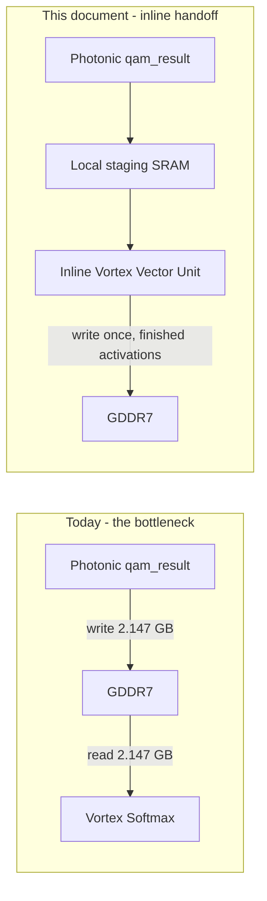

# Level 1 — Inline Vector Softmax & the Photonic-to-Vortex Handoff

Quantifies the GDDR7 round-trip Amdahl's Law bottleneck the hybrid partitioning
doctrine ([`06_70B_transformer_workload_trace.md`](06_70B_transformer_workload_trace.md)
sec. 2) creates if left unaddressed, and defines the fix: the Photonic Rx
Digital Recombiner's result stream feeds an **inline** Vortex vector unit —
data stays on-chip through Softmax, only the finished activations ever reach
GDDR7. This document is the gate `rtl/gcb_inline_vector_unit.sv`'s structural
skeleton is scaffolded against; the hardware TLU math itself is a later task.

> **Result.** For one LLaMA-70B-class prefill layer's attention softmax
> (N=4096, 64 heads, INT16 scores), writing the raw $N{\times}N$ score
> tensor to GDDR7 and reading it back before Softmax costs **4.295 GB** of
> avoidable traffic and **≈33.6 ms** of added latency at one GDDR7 device's
> peak bandwidth — **≈2.68 s across 80 layers**, or **≈9.5%** on top of the
> FFN compute-bound floor sec. 6 of doc 06 already established (28.19 s).
> None of that is optical or digital compute time; all of it is a single
> avoidable memory round trip. Keeping the data stationary removes it from
> the critical path entirely.

## 1. The Bottleneck: An $O(N^2)$ Round Trip Through GDDR7

Doc 06 sec. 2 routes attention's own matmuls ($QK^T$, $\mathrm{Attn}{\times}V$)
and Softmax to Vortex, and the QKVO projections that feed them to Photonic.
Naively, the two engines only meet at GDDR7: Photonic finishes a projection,
writes it out; Vortex starts its stage, reads it back in. For most of a
Transformer layer this is cheap — the projections and the FFN are $O(N)$ in
sequence length. Attention's own **score matrix is not**: it is
$N \times N$ per head, and Softmax must materialize (a numerically stable
implementation needs the row max before it can safely exponentiate) and
normalize every element of it.

### 1.1 Volume, one prefill layer

| given | value |
|---|---|
| Sequence length (prefill), $N$ | 4096 (doc 06's own prefill batch) |
| Attention heads | 64 (LLaMA-70B-class, doc 06 sec. 1) |
| Score elements per head | $N^2 = 4096^2 = 16{,}777{,}216$ |
| Score elements, all heads | $16{,}777{,}216 \times 64 = 1{,}073{,}741{,}824 \approx 1.074\times10^9$ |
| Precision | INT16 (2 B/elem — `accum_t`, `ACCUM_W=16`, `gcb_dwdm_pkg.sv`) |

$$\text{Raw score volume} = 1{,}073{,}741{,}824 \times 2\text{ B} = 2{,}147{,}483{,}648\text{ B} \approx \mathbf{2.147\ GB}$$

The bottleneck this document fixes is exactly two transfers of that volume —
Photonic writing the raw scores out, Vortex reading them back in, **before**
Softmax has even run:

$$\text{Avoidable round trip} = 2 \times 2.147\text{ GB} = \mathbf{4.295\ GB, per layer}$$

### 1.2 Latency, at GDDR7 rates already established (doc 05 sec. 8)

$$\text{Round-trip time} = \frac{4.295\text{ GB}}{128\text{ GB/s (one GDDR7 device)}} \approx \mathbf{33.6\ ms}$$

$$\text{Across 80 layers} = 33.6\text{ ms} \times 80 \approx \mathbf{2.68\ s}$$

Set against doc 06 sec. 7's own compute-bound floor for the FFN GEMMs alone
across all 80 layers (28.19 s, gate+up+down, $M{=}4096$ prefill):

$$\frac{2.68\text{ s}}{28.19\text{ s}} \approx \mathbf{9.5\%}\text{ added, on top of compute that is already accounted for}$$

This is the Amdahl's Law shape of the problem exactly: the optical engine can
be arbitrarily fast, and this 2.68 s does not shrink with it — it is a fixed
memory-round-trip tax paid once per layer, on the critical path, for data
that both engines need but neither is actually using while it's in transit.
It is also a **floor**, not a ceiling: it counts only the raw-score round
trip for attention Softmax specifically. Every other Photonic-output /
Vortex-input handoff a layer contains — RMSNorm before and after the FFN, the
$\mathrm{Attn}{\times}V$ output landing back at $W_O$ — pays the identical
tax if it also round-trips GDDR7, unaddressed by this document but the same
fix applies identically to each.

## 2. The Fix: The Photonic-to-Vortex Handoff

**Keep the data stationary.** The Rx Digital Recombiner's result stream
(`qam_result` / `qam_result_valid`, `NUM_CORES`-wide, straight off
`gcb_tensor_memory_engine`) feeds an **inline** Vortex vector unit directly,
on-die, instead of GDDR7:

- **Local SRAM staging buffer.** Holds one full row (length $N$, or the
  active tile width) of `qam_result` values as the Memory Engine streams
  them in, `qam_result_valid`-qualified beat by beat — the same
  `NUM_CORES`-parallel stream `gcb_tensor_memory_engine` already produces,
  simply not sent to GDDR7 first. Sized for numerically-stable Softmax's own
  requirement: the row max must be known before any element is exponentiated,
  so the full row must be resident before Softmax's first real step can run
  (see sec. 3) — this is a structural constraint on the buffer, not a
  convenience.
- **Inline Vortex Vector Unit.** Reads the staged row, computes Softmax
  entirely on-die (sec. 3), and is the only thing that writes back to
  GDDR7 — once, the finished, normalized activations. The raw pre-Softmax
  scores never reach GDDR7 at all; sec. 1's 4.295 GB simply does not happen.
- **Hardware TLU for $\exp(x)$.** A table lookup unit standing in for a
  transcendental function unit — Softmax's numerically stable form,
  $\mathrm{softmax}(x)_i = \dfrac{e^{x_i - \max(x)}}{\sum_j e^{x_j - \max(x)}}$,
  needs $\exp$ evaluated once per element, $N^2$ times per head per layer.
  A TLU (interpolated lookup table, precision TBD) keeps this a fixed-latency
  hardware op instead of an iterative digital approximation — the actual
  table contents and interpolation scheme are explicitly **not** designed
  yet (sec. 4).

## 3. Hardware Softmax, Structurally

Four-stage FSM (`rtl/gcb_inline_vector_unit.sv`'s skeleton, sec. 4), matching
the numerically-stable Softmax algorithm's own data dependencies exactly —
each stage's output is a real input the next stage cannot start without:

| state | reads | produces | why it's a separate stage |
|---|---|---|---|
| `ST_FIND_MAX` | staging SRAM, full row | $\max(x)$ | must see every element once before any $\exp$ is safe to evaluate (overflow) |
| `ST_TLU_EXP` | staging SRAM, full row; $\max(x)$ | $e^{x_i - \max(x)}\ \forall i$ | needs $\max(x)$ from the prior stage; this is where the TLU is invoked |
| `ST_SUM_EXP` | $e^{x_i-\max(x)}$ values | $\sum_i e^{x_i - \max(x)}$ | needs every exponentiated value, so cannot overlap the stage producing them element-by-element without a running-sum variant (sec. 4's skeleton keeps the stages separate; an online/fused variant is a later optimization, not a correctness requirement) |
| `ST_NORMALIZE` | $e^{x_i-\max(x)}$ values; the sum | $\mathrm{softmax}(x)_i\ \forall i$, streamed to GDDR7 | the only stage whose output is the thing that actually leaves the chip |

## 4. Explicitly Out of Scope (This Document, and the RTL Skeleton It Gates)

- The TLU's actual table contents, interpolation order, and fixed-point
  format for $e^x$ — `rtl/gcb_inline_vector_unit.sv` defines the FSM and
  interface boundary only; `ST_TLU_EXP` is a named, empty state.
- Fusing `ST_SUM_EXP` into `ST_TLU_EXP` (an online/running-sum Softmax) —
  a real, valid future optimization once the TLU itself exists; keeping them
  separate now keeps the skeleton's data dependencies legible.
- RMSNorm's own inline handoff, and $\mathrm{Attn}{\times}V$'s output landing
  back at $W_O$ without a GDDR7 round trip — sec. 1.2 established the same
  tax applies to both; both are the same fix, applied elsewhere, not
  designed here.
- Where the staging SRAM's capacity comes from in the Engine-Local SRAM
  budget doc 05 sec. 7 already sized — this document defines the interface
  and the row-buffering requirement; sizing it against the existing 9 MiB
  macro is a later task.

## Related

- [`05_photonic_memory_dataflow.md`](05_photonic_memory_dataflow.md) — the
  GDDR7 bandwidth figures (128 GB/s/device) sec. 1.2's latency estimate
  reuses directly, and the Engine-Local SRAM budget sec. 4 will eventually
  size the staging buffer against.
- [`06_70B_transformer_workload_trace.md`](06_70B_transformer_workload_trace.md)
  — the Photonic/Vortex partitioning this handoff sits at the boundary of,
  and the FFN compute-bound floor (28.19 s) sec. 1.2 compares the round-trip
  tax against.
- `rtl/gcb_tensor_memory_engine.sv` (`gcb-wdm-transceiver`) — the
  `qam_result` / `qam_result_valid` stream this handoff taps directly,
  unchanged, per sec. 2.
