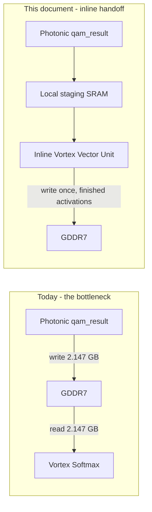

# Level 1 — Inline Vector Softmax & the Photonic-to-Vortex Handoff

Quantifies the GDDR7 round-trip Amdahl's Law bottleneck the hybrid partitioning
doctrine ([`06_70B_transformer_workload_trace.md`](06_70B_transformer_workload_trace.md)
sec. 2) creates if left unaddressed, and defines the fix: the Photonic Rx
Digital Recombiner's result stream feeds an **inline** Vortex vector unit —
data stays on-chip through Softmax, only the finished activations ever reach
GDDR7. This document is the gate `rtl/gcb_inline_vector_unit.sv`'s structural
skeleton is scaffolded against; sec. 4 defines the base-2 decomposition its
`ST_TLU_EXP` hardware math implements.

> **Result.** For one LLaMA-70B-class prefill layer's attention softmax
> (N=4096, 64 heads, INT16 scores), writing the raw $N{\times}N$ score
> tensor to GDDR7 and reading it back before Softmax costs **4.295 GB** of
> avoidable traffic and **≈33.6 ms** of added latency at one GDDR7 device's
> peak bandwidth — **≈2.68 s across 80 layers**, or **≈9.5%** on top of the
> FFN compute-bound floor sec. 6 of doc 06 already established (28.19 s).
> None of that is optical or digital compute time; all of it is a single
> avoidable memory round trip. Keeping the data stationary removes it from
> the critical path entirely.

## 1. The Bottleneck: An $O(N^2)$ Round Trip Through GDDR7

Doc 06 sec. 2 routes attention's own matmuls ($QK^T$, $\mathrm{Attn}{\times}V$)
and Softmax to Vortex, and the QKVO projections that feed them to Photonic.
Naively, the two engines only meet at GDDR7: Photonic finishes a projection,
writes it out; Vortex starts its stage, reads it back in. For most of a
Transformer layer this is cheap — the projections and the FFN are $O(N)$ in
sequence length. Attention's own **score matrix is not**: it is
$N \times N$ per head, and Softmax must materialize (a numerically stable
implementation needs the row max before it can safely exponentiate) and
normalize every element of it.

### 1.1 Volume, one prefill layer

| given | value |
|---|---|
| Sequence length (prefill), $N$ | 4096 (doc 06's own prefill batch) |
| Attention heads | 64 (LLaMA-70B-class, doc 06 sec. 1) |
| Score elements per head | $N^2 = 4096^2 = 16{,}777{,}216$ |
| Score elements, all heads | $16{,}777{,}216 \times 64 = 1{,}073{,}741{,}824 \approx 1.074\times10^9$ |
| Precision | INT16 (2 B/elem — `accum_t`, `ACCUM_W=16`, `gcb_dwdm_pkg.sv`) |

$$\text{Raw score volume} = 1{,}073{,}741{,}824 \times 2\text{ B} = 2{,}147{,}483{,}648\text{ B} \approx \mathbf{2.147\ GB}$$

The bottleneck this document fixes is exactly two transfers of that volume —
Photonic writing the raw scores out, Vortex reading them back in, **before**
Softmax has even run:

$$\text{Avoidable round trip} = 2 \times 2.147\text{ GB} = \mathbf{4.295\ GB, per layer}$$

### 1.2 Latency, at GDDR7 rates already established (doc 05 sec. 8)

$$\text{Round-trip time} = \frac{4.295\text{ GB}}{128\text{ GB/s (one GDDR7 device)}} \approx \mathbf{33.6\ ms}$$

$$\text{Across 80 layers} = 33.6\text{ ms} \times 80 \approx \mathbf{2.68\ s}$$

Set against doc 06 sec. 7's own compute-bound floor for the FFN GEMMs alone
across all 80 layers (28.19 s, gate+up+down, $M{=}4096$ prefill):

$$\frac{2.68\text{ s}}{28.19\text{ s}} \approx \mathbf{9.5\%}\text{ added, on top of compute that is already accounted for}$$

This is the Amdahl's Law shape of the problem exactly: the optical engine can
be arbitrarily fast, and this 2.68 s does not shrink with it — it is a fixed
memory-round-trip tax paid once per layer, on the critical path, for data
that both engines need but neither is actually using while it's in transit.
It is also a **floor**, not a ceiling: it counts only the raw-score round
trip for attention Softmax specifically. Every other Photonic-output /
Vortex-input handoff a layer contains — RMSNorm before and after the FFN, the
$\mathrm{Attn}{\times}V$ output landing back at $W_O$ — pays the identical
tax if it also round-trips GDDR7, unaddressed by this document but the same
fix applies identically to each.

## 2. The Fix: The Photonic-to-Vortex Handoff

**Keep the data stationary.** The Rx Digital Recombiner's result stream
(`qam_result` / `qam_result_valid`, `NUM_CORES`-wide, straight off
`gcb_tensor_memory_engine`) feeds an **inline** Vortex vector unit directly,
on-die, instead of GDDR7:

- **Local SRAM staging buffer.** Holds one full row (length $N$, or the
  active tile width) of `qam_result` values as the Memory Engine streams
  them in, `qam_result_valid`-qualified beat by beat — the same
  `NUM_CORES`-parallel stream `gcb_tensor_memory_engine` already produces,
  simply not sent to GDDR7 first. Sized for numerically-stable Softmax's own
  requirement: the row max must be known before any element is exponentiated,
  so the full row must be resident before Softmax's first real step can run
  (see sec. 3) — this is a structural constraint on the buffer, not a
  convenience.
- **Inline Vortex Vector Unit.** Reads the staged row, computes Softmax
  entirely on-die (sec. 3), and is the only thing that writes back to
  GDDR7 — once, the finished, normalized activations. The raw pre-Softmax
  scores never reach GDDR7 at all; sec. 1's 4.295 GB simply does not happen.
- **Hardware TLU for $\exp(x)$.** A table lookup unit standing in for a
  transcendental function unit — Softmax's numerically stable form,
  $\mathrm{softmax}(x)_i = \dfrac{e^{x_i - \max(x)}}{\sum_j e^{x_j - \max(x)}}$,
  needs $\exp$ evaluated once per element, $N^2$ times per head per layer.
  A TLU keeps this a fixed-latency hardware op instead of an iterative
  digital approximation — the base-2 decomposition that makes a single
  small ROM sufficient is sec. 4.

## 3. Hardware Softmax, Structurally

Four-stage FSM (`rtl/gcb_inline_vector_unit.sv`), matching the numerically
stable Softmax algorithm's own data dependencies exactly — each stage's
output is a real input the next stage cannot start without:

| state | reads | produces | why it's a separate stage |
|---|---|---|---|
| `ST_FIND_MAX` | staging SRAM, full row | $\max(x)$ | must see every element once before any $\exp$ is safe to evaluate (overflow) |
| `ST_TLU_EXP` | staging SRAM, full row; $\max(x)$ | $e^{x_i - \max(x)}\ \forall i$ | needs $\max(x)$ from the prior stage; this is where the TLU is invoked |
| `ST_SUM_EXP` | $e^{x_i-\max(x)}$ values | $\sum_i e^{x_i - \max(x)}$ | needs every exponentiated value, so cannot overlap the stage producing them element-by-element without a running-sum variant (sec. 4's skeleton keeps the stages separate; an online/fused variant is a later optimization, not a correctness requirement) |
| `ST_NORMALIZE` | $e^{x_i-\max(x)}$ values; the sum | $\mathrm{softmax}(x)_i\ \forall i$, streamed to GDDR7 | the only stage whose output is the thing that actually leaves the chip |

## 4. Base-2 Hardware Exponentiation (the TLU)

$e^x$ has no cheap direct hardware form, but $2^x$ does — a fixed-point
integer/fractional split, a shifter, and a small ROM, all of which already
exist as primitives elsewhere in this design. The identity that makes this
work:

$$e^x = 2^{x \cdot \log_2 e}, \qquad \log_2 e \approx 1.4426950408889634$$

Let $y = x \cdot \log_2 e$ and split it into an integer part $n = \lfloor y
\rfloor$ and a fractional part $f = y - n \in [0, 1)$:

$$e^x = 2^y = 2^{n+f} = \underbrace{2^n}_{\text{shift}} \times \underbrace{2^f}_{\text{ROM lookup}}$$

$2^n$ — an integer power of two — is a bit shift: cheap, exact, and (per
sec. 4.2) only ever a *right* shift here. $2^f$ for $f \in [0,1)$ is a
smooth, bounded ($[1, 2)$) function of a small fractional value — exactly
what a small ROM is for.

### 4.1 Fixed-point representation

$\log_2 e$ itself has to be a fixed-point constant to multiply in hardware.
Q8 (8 fractional bits — chosen to match the ROM's own address width, sec.
4.3):

$$\texttt{LOG2E\_Q8} = \mathrm{round}(1.4426950408889634 \times 256) = 369 = \texttt{10'h171}$$

$369/256 = 1.44140625$ — a $0.089\%$ relative error against the true
constant, from Q8 rounding alone. $y_{fixed} = x \times \texttt{LOG2E\_Q8}$
is then $y$ itself, represented in Q8 (i.e. $y = y_{fixed}/256$), computed
with one multiply: a 16-bit signed `x` (the score, `accum_t`) against a
10-bit signed constant gives a 26-bit signed product.

### 4.2 Splitting $y_{fixed}$ costs nothing extra — two's complement already
did it

For $x = \mathrm{score} - \max(\mathrm{scores})$ — sec. 3's numerically
stable form — $x \le 0$ always, so $y \le 0$ always, so $n \le 0$ always: no
left-shift case exists in this application, ever. This is exactly the
"handle the sign bit correctly" case: floor() of a two's-complement
fixed-point value is *not* the same operation as truncating a sign-magnitude
one, and getting this wrong is the standard way to introduce an off-by-one
at every negative boundary (e.g. $\lfloor -0.3 \rfloor = -1$, not $0$).

The reason it costs nothing extra: in two's complement, taking the top bits
of $y_{fixed}$ as a signed value via an **arithmetic** right shift already
computes $\lfloor y \rfloor$ correctly — for negative $y$ too — and the
bottom 8 bits, read as an **unsigned** value, are already $f \times 256$
exactly. No separate floor() or subtraction is needed:

$$n = y_{fixed} \texttt{ >>> } 8 \qquad\text{(arithmetic shift — sign-extends)}$$
$$f_{addr} = y_{fixed}\texttt{[7:0]} \qquad\text{(unsigned — directly addresses the ROM)}$$

### 4.3 The ROM: 256 entries, $2^f$ for $f = i/256,\ i \in [0,256)$

$$\texttt{TLU\_ROM}[i] = \mathrm{round}\!\left(2^{\,i/256} \times 256\right), \qquad i = 0 \ldots 255$$

Values run from `TLU_ROM[0] = 256` ($2^0 = 1.0$) to `TLU_ROM[255] = 511`
($2^{255/256} \approx 1.9915$) — real computed values (Q8 fixed point), not
placeholder or random hex; this is a genuine, working, unrounded-in-the-
mathematical-sense $2^f$ lookup, not a mock. What it deliberately still is:
a **zeroth-order** table (nearest-bin lookup, no interpolation between
entries). At 256 entries the bin width is $\Delta f = 1/256$, and $2^f$'s
own local slope near $f$ is $\approx \ln 2 \times 2^f$, so the ROM's *own*
step error from not interpolating is on the order of
$\ln 2 / 256 \approx 0.27\%$ relative, in isolation — small, and an
explicit, documented simplification (interpolation is a real, valid
future refinement, not implemented here). This is *not* the pipeline's
end-to-end error — sec. 4.4 measures that.

**Exact sizing.** Every entry's significant range is $[256, 511]$ — 9 bits
would hold it exactly — but `rtl/gcb_inline_vector_unit.sv` declares each
entry `logic [15:0]`, not `[8:0]`: 16 bits for byte alignment and headroom
against a future wider fixed-point format, at a real, accepted cost —

$$256 \times 16\ \text{bits} = 4{,}096\ \text{bits} = \mathbf{512\ B}$$

— against $256 \times 9 = 2{,}304$ bits ($288$ B) at the tight minimum: 224 B
(1.78x) spent on alignment, not precision. Trivial against the 9 MiB
Engine-Local SRAM macro (doc 05 sec. 7) this ROM sits beside — the choice
is stated here for completeness, not because the overhead is a concern.

### 4.4 Final scale: always a right shift, never a left one

$$e^x \approx \texttt{TLU\_ROM}[f_{addr}] \texttt{ >> } |n|$$

Because sec. 4.2 already established $n \le 0$ always in this application,
`|n|` is simply `-n`, and the shift is a single, always-present right shift
— no shift-direction mux, no left-shift datapath to build or verify. Very
negative `x` (far below the row max) drives `|n|` large enough to shift the
ROM value's few significant bits entirely out, correctly underflowing to
$0$ — exactly the behavior a distant-from-the-max Softmax term should have.

`>>` **truncates** (rounds toward zero), not round-to-nearest — the
simplest hardware, at the cost of compounding with sec. 4.1's $\log_2 e$
rounding and sec. 4.3's ROM step error rather than sitting cleanly beside
them. Measured directly against `rtl/gcb_inline_vector_unit.sv`, not just
derived: $x{=}{-1} \to 0.19\%$ error, $x{=}{-2} \to 1.9\%$,
$x{=}{-5} \to 42\%$ — **relative** error grows sharply as $x$ moves further
from the max, because truncation discards a growing fraction of an
already-small integer. This is the correct trade for Softmax specifically,
not a defect to fix later: a far-from-the-max term is already being driven
toward the correctly-negligible end of the distribution, so its worsening
*relative* precision never perturbs `ST_SUM_EXP`'s sum or the final
normalized output in any way that matters — the error concentrates exactly
where it is harmless. Sec. 4.3's $0.27\%$ figure remains true as stated,
scoped to the ROM step alone; quote it as that, not as this datapath's
overall accuracy.

### 4.5 Formally verified

The numbers above came from an ad hoc throwaway check while landing the
RTL. `tb/tb_gcb_inline_vector_unit.sv` (`gcb-wdm-transceiver`,
commit `8e5967d`) supersedes it with a committed, repeatable formal
testbench: an independent golden model re-derives the entire sec. 4
algorithm from scratch — including the 256-entry ROM, recomputed via real
$2^f$ arithmetic rather than copied from the RTL's own literal table, so a
shared typo could not self-confirm — and checks every output element
bit-exact, not within a tolerance. Result: 256/256 row elements correct
across 4 rows (one directed all-equal row plus 3 randomized wide-spread
rows), run as part of `sim/run_tb.sh`'s regression suite on every change
from here on. This document's algorithm and that RTL's implementation of
it are now proven to agree, not merely observed to agree once.

## 5. Explicitly Out of Scope (This Document, and the RTL Skeleton It Gates)

- Interpolating between adjacent ROM entries (sec. 4.3's $\approx 0.27\%$
  bound) — a real refinement once the zeroth-order version is verified, not
  designed here.
- Fusing `ST_SUM_EXP` into `ST_TLU_EXP` (an online/running-sum Softmax) —
  a real, valid future optimization once the TLU itself exists; keeping them
  separate now keeps the skeleton's data dependencies legible.
- RMSNorm's own inline handoff, and $\mathrm{Attn}{\times}V$'s output landing
  back at $W_O$ without a GDDR7 round trip — sec. 1.2 established the same
  tax applies to both; both are the same fix, applied elsewhere, not
  designed here.
- `ST_NORMALIZE`'s actual division ($e^{x_i-\max}/\sum_j e^{x_j-\max}$) — a
  hardware divider is its own task, arguably as much later-task numerics as
  $\exp$ was before this document; the ROM/shift datapath sec. 4 defines
  does not touch it.
- Where the staging SRAM's capacity comes from in the Engine-Local SRAM
  budget doc 05 sec. 7 already sized — this document defines the interface
  and the row-buffering requirement; sizing it against the existing 9 MiB
  macro is a later task.

## Related

- [`13_bitplane_tx_mapper.md`](13_bitplane_tx_mapper.md) — how the `qam_result`
  INT16 stream this handoff consumes is reconstructed from the optical
  cross-products (`Y = Σ W_i W_j S_ij`).
- [`05_photonic_memory_dataflow.md`](05_photonic_memory_dataflow.md) — the
  GDDR7 bandwidth figures (128 GB/s/device) sec. 1.2's latency estimate
  reuses directly, and the Engine-Local SRAM budget (sec. 7) will eventually
  size the staging buffer against.
- [`06_70B_transformer_workload_trace.md`](06_70B_transformer_workload_trace.md)
  — the Photonic/Vortex partitioning this handoff sits at the boundary of,
  and the FFN compute-bound floor (28.19 s) sec. 1.2 compares the round-trip
  tax against.
- `rtl/gcb_tensor_memory_engine.sv` (`gcb-wdm-transceiver`) — the
  `qam_result` / `qam_result_valid` stream this handoff taps directly,
  unchanged, per sec. 2.
- `rtl/gcb_inline_vector_unit.sv` and `tb/tb_gcb_inline_vector_unit.sv`
  (`gcb-wdm-transceiver`) — sec. 3's FSM and sec. 4's base-2 TLU math, and
  the formal testbench proving them bit-exact (sec. 4.5).
