# GCB — Probable Silicon Product

## 10,000-Foot Architecture View

> **Purpose:** This is an architectural inference, not a frozen implementation specification. It deliberately makes educated guesses about what the present GCB work is likely to become at silicon scale.

## Executive view

If we step back to the **10,000-foot architecture level**, the materials point toward a recognizable silicon product.

I would **not** describe GCB as an "optical ADC chip." That is much too narrow.

My strongest guess is:

> **GCB Photonic Compute Tile — a heterogeneous silicon/chiplet accelerator that presents ordinary linear-algebra operations to software while performing the dominant multiply/reduction work optically.**

The key architectural idea is that the optical fabric is a **specialized execution engine**, not the entire computer.

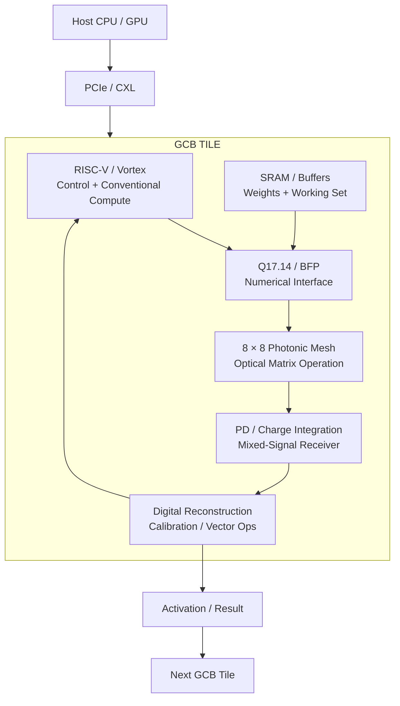

The architecture therefore looks less like a magical photonic processor and more like a conventional accelerator wrapped around an unusual physical execution unit.

---

# 1. Two likely physical levels

I don't think the eventual implementation necessarily wants to be one giant monolithic die containing everything.

A more natural physical realization is likely to separate the digital compute/control domain from the photonic and mixed-signal domain.

## Level 1 — GCB digital compute die

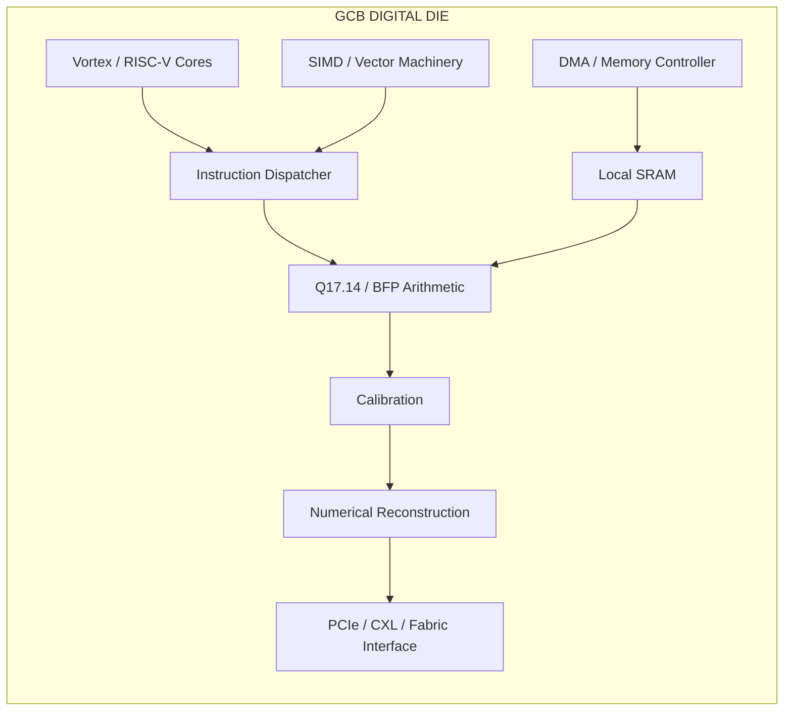

This side is where the architecture can remain relatively conventional: control, memory management, vector operations, calibration, reconstruction, nonlinear operations, and system interfaces.

## Level 2 — photonic / mixed-signal die

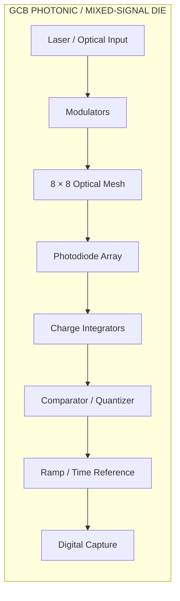

The important architectural boundary is therefore:

**photons → mixed-signal receiver → digital numerical representation.**

That receiver is not merely an ADC peripheral. It is the interface between optical computation and the digital computer.

---

# 2. The receiver experiment is more important than "an ADC"

The current receiver work is really defining the interface where optical computation becomes a number.

Conceptually:

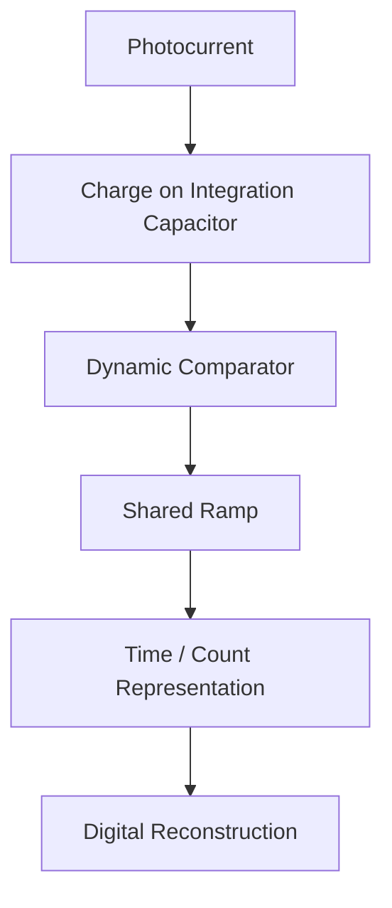

The current design assumptions make this a real mixed-signal macro rather than an abstract block:

- 2 pF integration capacitor
- 6 GHz clock
- 4-phase capture
- nominal 12-bit conversion
- 256 ns observation window
- approximately 0.74 µA RMS photocurrent
- approximately 56 dB SNDR target

The architectural implication is:

> **GCB is defining the silicon boundary where photons become numerical values.**

That may ultimately be one of the most important blocks in the entire project.

---

# 3. What first silicon might look like

For a realistic first product, I would make the initial device substantially smaller than the ultimate system.

I would expect something conceptually like:

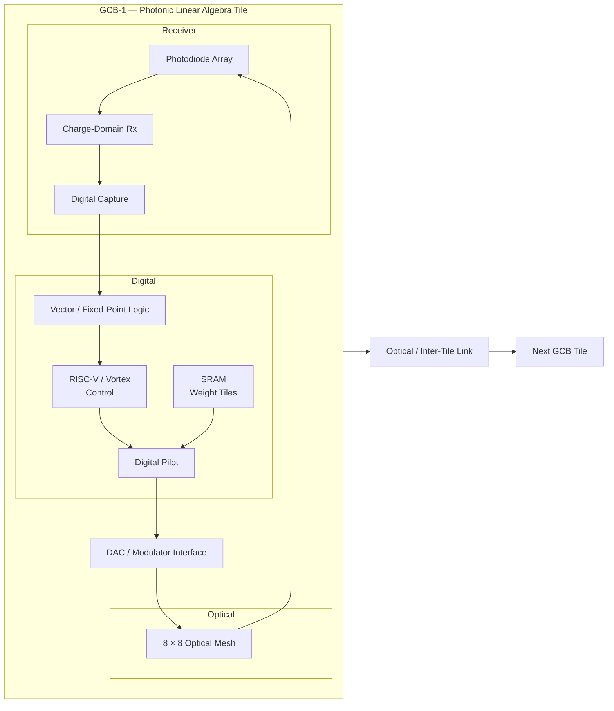

The crucial point is that the optical mesh is **not the whole accelerator**.

It is a specialized execution unit.

That is why the software abstraction can remain conventional.

---

# 4. The software view should be boring

This is probably the most important strategic observation.

The application should not need to know that the calculation happened optically.

A target programming model could remain as ordinary as:

```python
C = A @ B
```

while the execution path becomes:

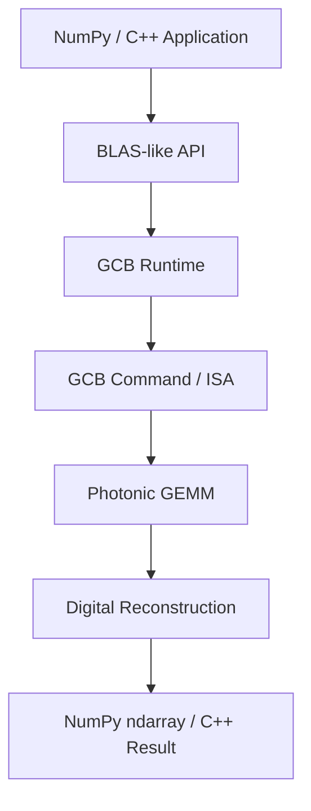

A GCB command such as `OP_GEMM` is therefore an implementation detail beneath a conventional linear-algebra interface.

The software ecosystem does not need to expose "photonic instructions" to the programmer.

**The exotic part is underneath the API.**

---

# 5. What GCB should probably be called

I would avoid these descriptions:

- photonic computer
- optical ADC
- optical GPU

Each emphasizes the wrong architectural boundary.

My preferred description is:

> **A heterogeneous photonic linear-algebra processor whose optical execution fabric performs high-dimensional multiply/reduction operations while conventional silicon handles control, nonlinear operations, memory management, and numerical reconstruction.**

That description captures the division of labor.

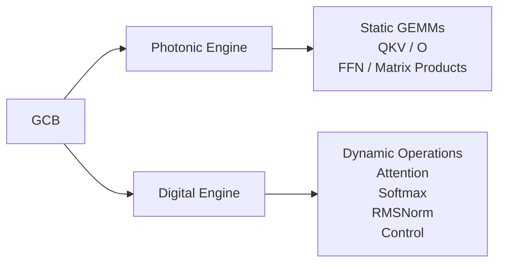

The architectural principle is therefore:

**photons do what physics is good at; digital logic does what programmability and data dependence require.**

---

# 6. The scaling story

The DIY → workstation → server → frontier progression becomes much clearer if the fundamental unit is a replicated tile rather than one enormous photonic die.

## DIY


One tile is enough to demonstrate the basic optical linear-algebra execution path.

## Enthusiast / workstation

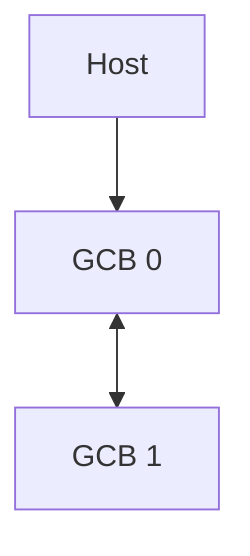

Multiple tiles begin to expose parallelism.

## Server

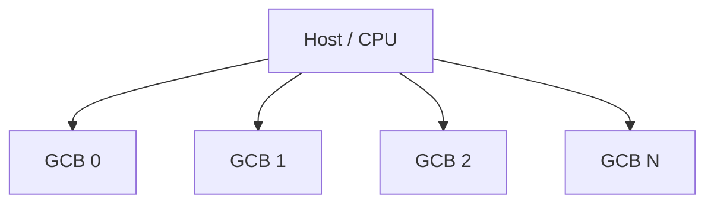

## Frontier

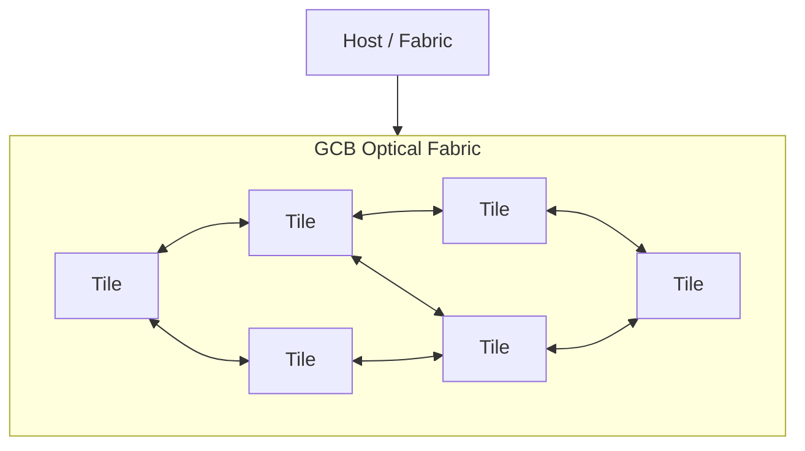

The important scaling insight is:

> **Do not make one GCB tile enormous. Make the tile cheap, composable, software-transparent, and extremely efficient at linear algebra.**

That creates a credible path from one experimental tile to a many-tile accelerator fabric.

---

# 7. What receiver PASS actually unlocks

If the receiver experiment passes, I would **not** say:

> "We have built a photonic GPU."

I would say:

> **We have removed one of the fundamental unknowns preventing a photonic linear-algebra processor from becoming a silicon architecture.**

The resulting architecture becomes:

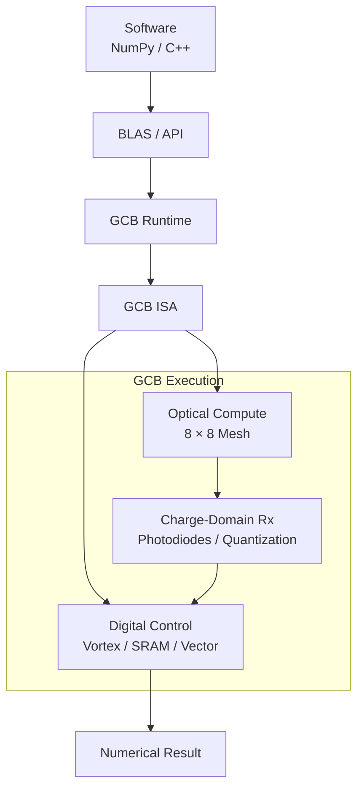

That is a **real computer architecture**, rather than simply a photonics experiment.

The deeper design flow is:

1. determine what numerical error the network tolerates;
2. determine what physical energy is required to achieve it;
3. compose those constraints into the system architecture.

---

# 8. What if the receiver fails?

A receiver failure does not necessarily kill GCB.

It could kill **this receiver implementation**.

That distinction matters.

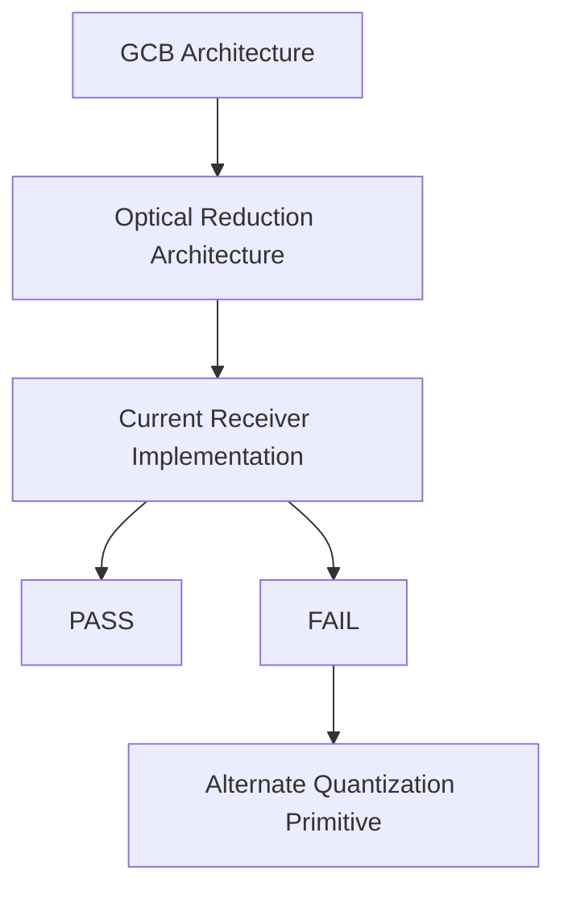

The real project-killing question is higher in the hierarchy:

> **At the numerical precision actually required by the model, does physical optical reduction still consume less energy than digital reduction?**

That is the fundamental GCB kill condition.

A different receiver architecture can preserve the larger architectural thesis.

---

# 9. Strongest silicon prediction

If I had to name the probable eventual physical object today, without pretending the design is finalized, I would call it:

## GCB Photonic Compute Tile (PCT)

with three primary technological domains:

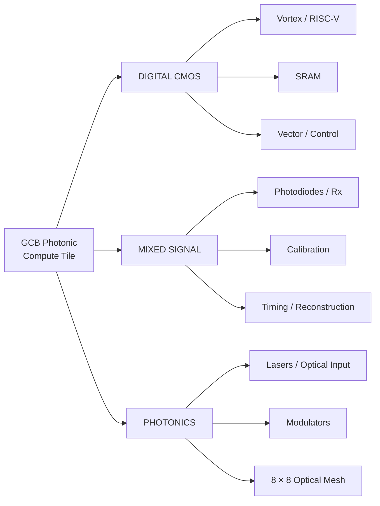

A fourth physical component may be external/package memory:

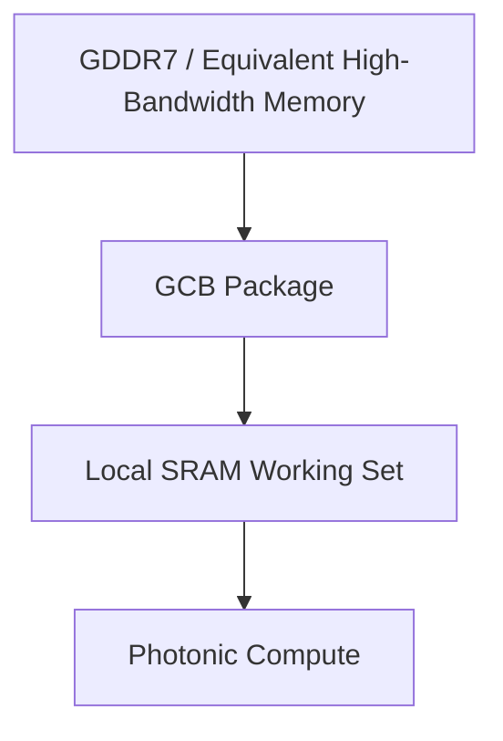

The mature product therefore looks less like:

> **one magical photonic chip**

and more like:

> **a tightly integrated compute package containing a conventional digital accelerator, local SRAM, mixed-signal optical receivers, and a photonic matrix engine.**

---

# 10. Confidence assessment

| Prediction | Confidence |
|---|---|
| GCB becomes a photonic linear-algebra accelerator | **Very high** |
| Optical engine acts as a specialized GEMM/reduction unit | **Very high** |
| Vortex/RISC-V remains the digital control/general-compute side | **High** |
| Local SRAM is critical | **Very high** |
| Receiver is local to photonic computation | **Very high** |
| 8 × 8 optical mesh becomes a replicated compute primitive | **High** |
| First implementation is heterogeneous rather than pure monolithic CMOS | **High** |
| Multiple GCB tiles form the scaling mechanism | **Very high** |
| NumPy/C++ sees ordinary matrix operations | **High** |
| GCB eventually resembles a CUDA-like compute platform architecturally | **Medium-high** |
| One enormous die is the frontier implementation | **Low** |
| Chiplet/package-level scaling is the frontier implementation | **High** |

---

# Bottom line

The likely endgame is **not**:

> "make the GCB chip enormous."

It is:

> **Make the GCB tile cheap, composable, software-transparent, and extraordinarily efficient at linear algebra.**

If that works, the progression becomes remarkably clean:


That is the probable silicon story hiding underneath the current experiments.

---

## Important distinction: current analog status

The current analog receiver should be treated as **CONDITIONAL GO**, not unconditional GO, until the commercial transient-noise histogram closes the surrogate-model uncertainty.

The digital RTL work can proceed in parallel because it does not depend on resolving that final analog-model uncertainty.

That means the project has crossed an important boundary:

> **The question is no longer primarily "can the circuit concept work?" It is becoming "what exactly is the digital machine surrounding the photonic computation?"**

