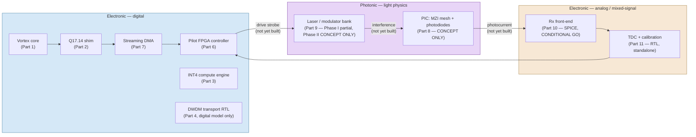
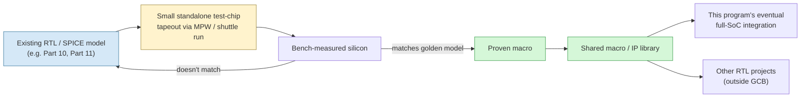

# Appendix: Silicon & Package Detail — Electronics vs. Photonics, Chip by Chip

> **Why this page exists.** The lenses give an entry-level view of "the
> silicon." This page answers the question that view can't: *for any
> one of the would-be chips in this program, is it electronic or
> photonic, what real work exists on it today, and what would it take
> to package it?* Not the source of truth — every status below traces
> to [`16_hardware_parts_systems_specification.md`](https://github.com/jagreen03/gcb-wiki/blob/main/16_hardware_parts_systems_specification.md)
> (the full 17-part engineering inventory this page summarizes and
> organizes by domain, not duplicates) and to
> [`manufacturing-pdk.md`](manufacturing-pdk.md) (the real physical-design
> numbers and the tapeout/package/PCB gap list). Read those two for
> primary evidence; read this page for the map between them.

## The one-paragraph answer

**Both, and they don't touch yet.** GreenCoyote-Bay is one system with
three physically different substrates: ordinary digital logic
(electronic), a mixed-signal analog front-end (also electronic, but a
different discipline from digital logic), and a photonic integrated
circuit (light, not electrons, doing the actual multiply). Every
digital and analog piece has *some* real design evidence — RTL,
simulation, or a SPICE deck. The photonic piece has an architecture and
a toolchain, but as of this writing **no physical layout exists for
it** — it is the least mature of the three. None of the three has ever
been fabricated, packaged, or put on a PCB.

## Domain map — every real component, tagged

| # (per Part 16) | Component | Domain | Real status today | Repository |
|---|---|---|---|---|
| 1 | Vortex 3.0 RISC-V/GPGPU core | Electronic — digital (third-party) | Upstream-mature; **this program's** integration is RTL-simulated only | `vortex/` (vendored) |
| 2 | Q17.14 tile-writeback shim | Electronic — digital | RTL, simulated | `gcb-rtl/integration/` |
| 3 | INT4 Tensor Compute Engine | Electronic — digital | RTL, simulated, lint-clean, 9-Makefile cocotb regression surface | `gcb-wdm-transceiver/rtl/` |
| 4 | DWDM optical **transport** datapath | Electronic — digital (models an optical scenario, drives no real light) | RTL, simulated — most heavily adversarially tested block in the program; **one open defect** (epoch-tag aliasing) | `gcb-wdm-transceiver/rtl/` |
| 5 | Photonic QAM V2.0 digital receiver prototype | Electronic — digital (a digital *stand-in* for the eventual photonic receiver) | RTL + per-module testbenches + a numerical model; explicitly makes **no optical-feasibility claim** | `gcb-photonic-qam-v2/rtl/` |
| 6 | Digital Pilot FPGA controller | Electronic — digital, FPGA target | RTL, simulated; targeted at Alveo U55C, **not bench-verified on one** | `gcb-rtl/rtl/` |
| 7 | Streaming Tensor DMA | Electronic — digital | RTL, simulated | `gcb-rtl/rtl/` |
| 8 | Photonic Integrated Circuit — MZI mesh + photodiodes | **Photonic** | **CONCEPT ONLY** — architecture + toolchain selected; **no `gdsfactory` layout, no GDS, no extracted loss figure exists on disk yet** | `gcb-pic-core/` |
| 9 | Laser/modulator bank | **Photonic / electro-optic** | **Phase I: partially real** — candidate parts exist, but two `gcb-spec` documents disagree on laser *count* (4–8 independent diodes vs. one split via a PM splitter — `GCB-043`, unresolved). **Phase II: CONCEPT ONLY**, zero spec at the real 64-channel target. The "8×8 unitary mesh" language is a real, `gcb-spec`-grounded bench-emulation proxy — explicitly not a WDM claim | `gcb-spec/task3_physical_bom.md`, `gcb-spec/bench_emulation_parameters.md` |
| 10 | On-die mixed-signal Rx front-end | Electronic — **analog** | SPICE-characterized on ASAP7 (academic PDK), **CONDITIONAL GO** — one modeling uncertainty open | `gcb-analog-rx/`, `gcb-spec/models/readout/` |
| 11 | Shared TDC + calibration back-end | Electronic — digital | RTL, simulated, bit-exact vs. a Python golden model — **standalone only, not wired into the FPGA top module** | `gcb-rtl/rtl/` |
| 12 | Phase I bench receiver (COTS PD+TIA+ADC) | Electronic — analog (COTS parts, not GCB silicon) | RTL interface simulated; physical parts are `[CANDIDATE]`, none purchased/populated | `gcb-rtl/rtl/`, `gcb-spec/task3_physical_bom.md` |
| 13 | Bench DAC stimulus interface | Electronic — digital+analog (COTS) | RTL, simulated; `[CANDIDATE]` part (AD9767), not purchased | `gcb-rtl/rtl/` |
| 14–16 | Host driver, orchestrator, dashboard | **Software** (not silicon) | Real, running code — out of scope for this page | `gcb-host/`, `gcb-python-orchestrator/`, `gcb-dashboard/` |
| 17 | Mechanical chassis/backplane | Mechanical (concept art) | AI-rendered concept images only, no engineering content | `gcb-spec/concepts/` |

**Read this table as the direct answer to "is it electronics or
photonics":** everything digital (1–7, 11) and everything analog
(10, 12, 13) is **electronic** — ordinary semiconductor logic and
analog circuits, just at different levels of completion. Only **8 and
9** are **photonic** — light physics, waveguides, interference — and
they are also the two least-built parts in the entire inventory. The
program's actual compute *result* depends on both working together
(the photonic mesh does the multiply; the electronic front-end reads
it out), which is exactly why it's easy to get the two mixed up when
reading the lenses at a glance.

**Every arrow crossing into or out of the photonic box above is a
connection that does not physically exist yet.** The digital side
(blue) has real RTL and simulation on every block. The analog side
(orange) has a real SPICE deck on Part 10. The photonic side (purple)
has neither — it is architecture and toolchain choice only, as of this
writing.

## Package & interconnect — a genuinely different problem per domain

**None of these parts has a package, a PCB, or a tapeout of any kind.**
That gap list already exists in full at
[`manufacturing-pdk.md` Part 2](manufacturing-pdk.md#part-2-what-is-not-yet-real-tapeout-package-pcb-board-physical-test)
— it is not repeated here. What *is* worth stating explicitly, because
it is easy to miss if you've only worked in one domain, is that
**"packaging" means a different discipline depending on which chip you
mean**:

| If the chip is... | Packaging means | Who owns that discipline |
|---|---|---|
| The digital ASIC (Parts 1–7, 11 — if ever taped out as one die) | Wire-bond or flip-chip die attach, a substrate/leadframe, a BGA or QFN footprint, standard digital-IC thermal and signal-integrity rules | A silicon/package engineer, same skill set regardless of what the chip computes |
| The analog front-end (Part 10, if ever taped out) | Same die-attach disciplines as digital, but with much tighter attention to substrate noise coupling and parasitic capacitance on the sensitive integration node | A mixed-signal package engineer — a narrower specialty than pure-digital packaging |
| The photonic IC (Part 8) | **Optical** packaging: fiber-to-chip or edge coupling, grating coupler alignment (sub-micron tolerances), often no wire bonds at all for the optical I/O itself (only for any on-chip electrical drive/readout), and separate thermal management for any on-chip laser or modulator | A photonics packaging engineer — a genuinely different job from either row above, not a variant of it |

This is precisely the distinction a mechanical engineer scoping
enclosures needs to know before assuming one packaging plan covers the
whole system: **there is no single "the package" for GreenCoyote-Bay.**
If this program ever reaches tapeout, it will need at minimum two
separate packaging efforts (electronic die, photonic die), likely
co-packaged onto one interposer or module in the long run, but nothing
in this program's real artifacts today specifies that co-packaging
plan — it does not exist yet, even as a sketch.

## Proposed idea (not yet started, not yet committed): small per-block test chips as a shared library strategy

> **Epistemic status: PROPOSED IDEA — NOT STARTED, NOT COMMITTED.**
> Distinct from every "CONCEPT ONLY" label above, which describes a
> part of the *existing* system architecture that just hasn't been
> built yet. This section describes a **process idea** raised in
> discussion with the Architect about *how* this program might
> eventually get to silicon — it has no ADR, no ticket, and no
> `gcb-spec` grounding. Read it as a suggestion on the table, not as
> this program's roadmap.

Every "not started" row in `manufacturing-pdk.md`'s gap list exists
because a full-chip tapeout is an expensive, all-or-nothing
commitment: you cannot cheaply learn "did the homodyne readout cell
actually work in silicon" without first committing an entire chip's
worth of area, mask cost, and schedule to finding out. One way other
programs de-risk this is to **tape out the individual blocks
separately, small, and cheap, before ever committing to the full
integrated chip**:

1. Pick one real, already-designed block that would benefit most from
   silicon truth over simulation — Part 10 (the analog Rx front-end,
   already SPICE-characterized and closest to tapeout-ready) or a
   single homodyne multiplier tile from Part 8 are the natural first
   candidates, precisely because they already have the most design
   work behind them of anything in the inventory.
2. Submit that one block, alone, as a **small test die** through a
   low-cost multi-project-wafer (MPW) shuttle run (the kind of run
   "Tiny Tapeout"-class programs use) rather than waiting for a
   full-chip commitment.
3. Bench-test the returned silicon against the existing SPICE/RTL
   golden models — turning Part 10's "CONDITIONAL GO" (SPICE only,
   this appendix's own table above) into an actual measured result,
   the same kind of closure `manufacturing-pdk.md` currently lists as
   entirely missing.
4. **Whatever block passes becomes a proven macro in a shared library**
   — not just for this program's own eventual full-chip integration,
   but potentially reusable RTL/layout IP for *other* projects that
   need the same building block (a homodyne readout cell, a
   single-slope TDC, a switched-charge integrator are all generically
   useful mixed-signal blocks, not GCB-specific once proven).

**What this idea would actually require, honestly stated:** an MPW
shuttle submission (real cost and schedule, even at small scale), a
commercial or shuttle-compatible PDK (ASAP7's predictive nature per
`manufacturing-pdk.md` means it cannot be submitted as-is — this is the
same commercial-PDK re-implementation step that appendix already lists
as required for *any* real ASIC path), and a board-level test fixture
for whichever block is chosen first. None of that exists today. This
section is recorded so the idea isn't lost, not because any of its
prerequisites have been met.

## See also

- [`manufacturing-pdk.md`](manufacturing-pdk.md) — the full digital
  physical-design evidence (Part 1) and the complete tapeout/package/
  PCB/test gap list (Part 2) this page builds on.
- [`16_hardware_parts_systems_specification.md`](https://github.com/jagreen03/gcb-wiki/blob/main/16_hardware_parts_systems_specification.md) —
  the full 17-part engineering inventory (part numbers, interfaces,
  data formats, dependencies, and standalone testability for every
  component), the primary source for every status claim on this page.
- [`lenses/01-silicon-architect.md`](../lenses/01-silicon-architect.md) —
  the entry-level silicon lens this page gives the deep-dive behind.
