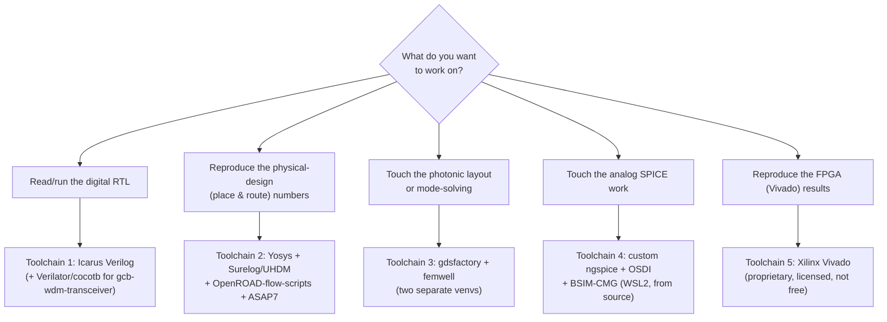

# Appendix: Installing the Toolchain — A Base Reference

> **Why this page exists.** [`sagas/saga-08-student.md`](../sagas/saga-08-student.md)
> names the real, runnable open-source tools this program actually
> uses. Installing all of them at once is genuinely complex — five
> mostly-independent toolchains, one of which (the analog SPICE stack)
> is a from-source build with no shortcut. This page is a map: what
> each toolchain is for, the real install path, and the gotchas this
> program's own sessions already hit — so you don't have to rediscover
> them. **Not the source of truth** — every command below traces to a
> real file in the cited repository; where this program has its own
> setup script or doc already, this page points to it rather than
> re-explaining it.

## Pick your path first

You almost certainly don't need all five toolchains. Pick based on
what you want to touch:



## Toolchain 1 — Digital RTL simulation

**For:** reading and running the SystemVerilog testbenches most of the
program's own verification evidence rests on (`gcb-rtl/sim/`).

| Tool | Version floor | Used by |
|---|---|---|
| **Icarus Verilog** (`iverilog`) | — | `gcb-rtl/sim/run_dma_tb.sh`, `run_pilot_tb.sh`, `run_ss_tb.sh` |
| **Verilator** | 5.032 | `gcb-wdm-transceiver/sim/lint.sh`, `sim/run_tb.sh`; `gcb-photonic-qam-v2/sim/` |
| **Cocotb** (Python) | 1.9 | Per-module Makefiles in `gcb-wdm-transceiver` (`Makefile.mac_tile_array`, etc.) |

**Install:**

```bash
# Icarus Verilog — packaged on every major distro
sudo apt install iverilog        # Debian/Ubuntu
brew install icarus-verilog      # macOS

# Verilator — build from source if your distro's package is older than 5.032
sudo apt install verilator       # check `verilator --version` first
# or: git clone https://github.com/verilator/verilator && cd verilator \
#     && git checkout v5.032 && autoconf && ./configure && make -j && sudo make install

# Cocotb
pip install cocotb==1.9.*
```

**Verify:** `bash gcb-rtl/sim/run_dma_tb.sh` should print `ALL CHECKS
PASS`. `bash gcb-wdm-transceiver/sim/lint.sh` should report 36/36 tops
clean under Verilator `-Wall`.

**No gotchas here** — this is the lightest toolchain in the program and
the right place to start.

## Toolchain 2 — Digital synthesis & physical design

**For:** reproducing the real ASAP7/OpenROAD place-and-route numbers in
[`manufacturing-pdk.md`](manufacturing-pdk.md) Part 1.

| Tool | Version floor | Role |
|---|---|---|
| **Yosys** | 0.52 | RTL synthesis |
| **Surelog / UHDM** plugin | current | Parses real SystemVerilog-2017 (packages, parameterized interfaces) that Yosys's own front end can't — this is *required*, not optional, for this program's RTL |
| **OpenROAD-flow-scripts** | current | Floorplan → place → CTS → route → GDSII |
| **ASAP7 PDK** | r1p7 | The predictive 7 nm-class academic PDK every number is measured against |

**Install:**

```bash
git clone --recursive https://github.com/The-OpenROAD-Project/OpenROAD-flow-scripts.git ~/eda/OpenROAD-flow-scripts
cd ~/eda/OpenROAD-flow-scripts
./build_openroad.sh --local        # builds OpenROAD + Yosys + the ASAP7 platform config together
source ./env.sh
```

This program's own real runs used exactly this checkout layout
(`~/eda/OpenROAD-flow-scripts/flow`, `source ../env.sh`) — see the
`GCB-027`–`GCB-032` findings docs in `gcb-workspaces/backlog/` for the
actual invocations against this repo's RTL.

**Gotchas, from this program's own experience:**

- **ASAP7 is predictive, not a real foundry process.** It will run
  fine and produce real numbers — those numbers describe "what this
  logic looks like against a research PDK," never a manufacturable
  design. See `manufacturing-pdk.md` before quoting any figure it
  produces.
- **Memory matters more than you'd expect.** This program's own
  tensor-B-operand placement run was killed by the build host's memory
  ceiling at 1.4M µm² / 32 macros — check available RAM before
  attempting a large design, and don't assume a "small" RTL block
  stays small once macros are placed.
- **SRAM macros come from FakeRAM2.0**, a geometrically-real,
  power-fake blackbox generator — expected and fine for area/timing
  work, **not valid for any power/thermal claim** (see
  `manufacturing-pdk.md`'s explicit warning on this).

## Toolchain 3 — Photonic layout & mode-solving

**For:** the `gcb-pic-core` waveguide/MMI layout and mode-solve work
(the photonic side of [`silicon-and-package-detail.md`](silicon-and-package-detail.md)).

| Tool | Role | This program's confirmed version |
|---|---|---|
| **gdsfactory** | Programmatic photonic-IC layout (Python) | 9.50.0 |
| **femwell** | Pure-Python FEM eigenmode solver | 0.1.12 |

**Install — two separate venvs, deliberately:**

```bash
python3 -m venv ~/.venvs/gdsfactory
~/.venvs/gdsfactory/bin/pip install -r gcb-pic-core/requirements.txt   # gdsfactory, numpy

python3 -m venv ~/.venvs/femwell
~/.venvs/femwell/bin/pip install femwell     # ~90s, pure Python, no native build
```

**Why two venvs, not one:** femwell pulls in a much heavier,
partially-overlapping dependency tree (VTK, cadquery-ocp, gmsh,
scikit-fem) than gdsfactory needs. This program deliberately keeps
femwell isolated rather than risk destabilizing an already-verified
gdsfactory environment — do the same rather than combining them.

**A real trap to know about before you go looking for other solvers:**
this program surveyed FDTD/EME options and found the obvious ones
don't actually work the way you'd expect —

- The **`meep` package on PyPI is a name collision** with an unrelated
  CI/CD task runner, not the MIT FDTD electromagnetic simulator (which
  is only distributed via `conda-forge`, not `pip`, under that name).
  `pip install meep` will succeed and install the wrong thing entirely.
- **`tidy3d`** is a real FDTD tool, but requires an external cloud
  account and API key — this program has not created one, and you
  should get your own project's authorization before you do either.
- **femwell** was chosen specifically because it's real, open-source,
  pure-Python, and installs cleanly with no license and no cloud
  dependency — at the cost of being a FEM mode-solver, not a full FDTD
  tool, so it answers a narrower set of questions.

**Verify:** `python gcb-pic-core/mode_solve_strip.py` (femwell venv)
should complete a real strip-waveguide mode solve.

## Toolchain 4 — Analog SPICE (the hardest one)

**For:** reproducing the SPICE-characterized results behind Part 10's
"CONDITIONAL GO" status (the on-die mixed-signal Rx front-end).

**Honestly stated up front: no packaged `ngspice` supports what this
program needs.** Both Debian's `ngspice` 45.2 and conda-forge's
`ngspice` 41 lack BSIM-CMG (MOSFET level 72) and OSDI support entirely
— this isn't a version-pinning problem, it's a missing feature in
every prebuilt package. The only path is a from-source build.

**This program already has a complete, idempotent, no-root install
script for exactly this** —
[`gcb-spec/scripts/setup_spice_env.sh`](https://github.com/jagreen03/gcb-spec/blob/main/scripts/setup_spice_env.sh),
documented in full at
[`gcb-spec/docs/spice_setup.md`](https://github.com/jagreen03/gcb-spec/blob/main/docs/spice_setup.md).
Use that script rather than hand-rolling the build — it already
handles the ngspice-44 build with `--enable-osdi`, compiles BSIM-CMG
111 from Verilog-A via OpenVAF, and fetches the real ASAP7 PDK cards:

```bash
bash gcb-spec/scripts/setup_spice_env.sh          # full build, idempotent, ~6 min
bash gcb-spec/scripts/setup_spice_env.sh --check  # verify an existing install
eval "$(bash gcb-spec/scripts/setup_spice_env.sh --env)"   # load env vars
```

**Platform requirement:** WSL2 Ubuntu, no root/sudo needed — this is
not a native-Windows or plain-macOS toolchain. **Network required**
(git clones + one prebuilt binary fetch). **Disk footprint** ≈ 1.5 GB.

**If you only remember one thing from this section:** don't `apt
install ngspice` and expect it to work for this program's models — it
will install successfully and then fail to find BSIM-CMG, because that
model support genuinely isn't in the stock package.

## Toolchain 5 — FPGA bring-up (proprietary, not free)

**For:** reproducing the real Vivado place-and-route numbers on
`greencoyote_top` (WNS = +0.261 ns, `xcu55c-fsvh2892-2L-e`).

**This is the one tool in the entire stack that is not open-source.**
Xilinx (AMD) **Vivado** requires a license and a multi-gigabyte
installer from AMD directly — there is no `pip install` or `apt
install` equivalent, and no free/open substitute exists for a
commercial Xilinx FPGA target. If you don't already have institutional
or personal access to Vivado, this is the one toolchain to skip rather
than try to work around — everything else in this program (RTL sim,
physical design, photonics, analog SPICE) is fully reproducible without
it.

## Summary table

| Toolchain | Cost | Platform | Setup effort | Skip if... |
|---|---|---|---|---|
| 1. Digital RTL sim | Free | Any | Minutes | Never — start here |
| 2. Synthesis/physical design | Free | Linux (WSL2 OK) | ~30–60 min build | You only care about behavior, not area/timing |
| 3. Photonics layout/mode-solve | Free | Any | ~10 min, two venvs | You're not touching `gcb-pic-core` |
| 4. Analog SPICE | Free, but from-source | WSL2 Ubuntu only | ~6 min script, real build | You're not touching `gcb-analog-rx`/readout SPICE |
| 5. FPGA (Vivado) | **Licensed, paid** | Windows/Linux | Hours (installer alone) | You don't have institutional Xilinx access |

## See also

- [`sagas/saga-08-student.md`](../sagas/saga-08-student.md) — the
  narrative tour of what these tools let you actually verify.
- [`lenses/03-software-integrator.md`](../lenses/03-software-integrator.md) —
  the host-software/API side, which uses a much lighter Python-only
  toolchain (`gcb-python-orchestrator/requirements.txt`) not covered
  above because none of it needs special install steps.
- [`10_open_source_eda_toolchain.md`](https://github.com/jagreen03/gcb-wiki/blob/main/10_open_source_eda_toolchain.md) —
  the design *rationale* for Toolchains 1 and 2 (why Verilator, why
  Surelog/UHDM instead of `sv2v`, why no Chisel/Amaranth-class
  generator) — this page covers installation, that one covers why.
