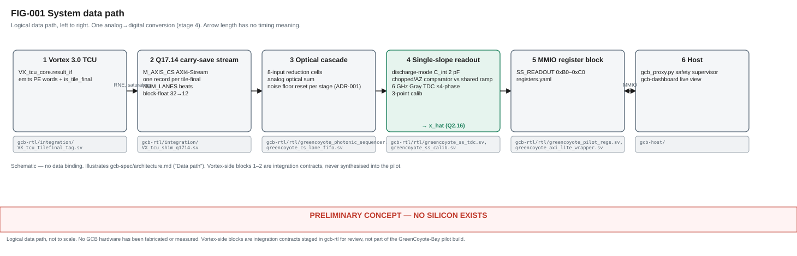
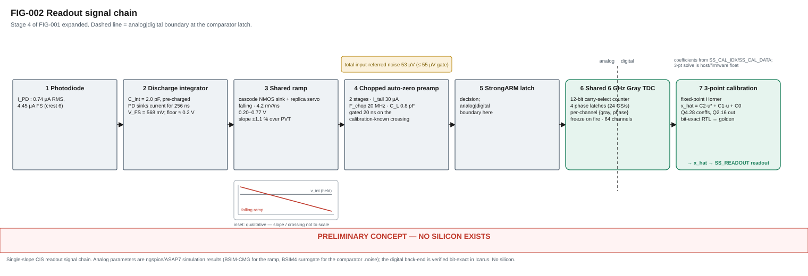
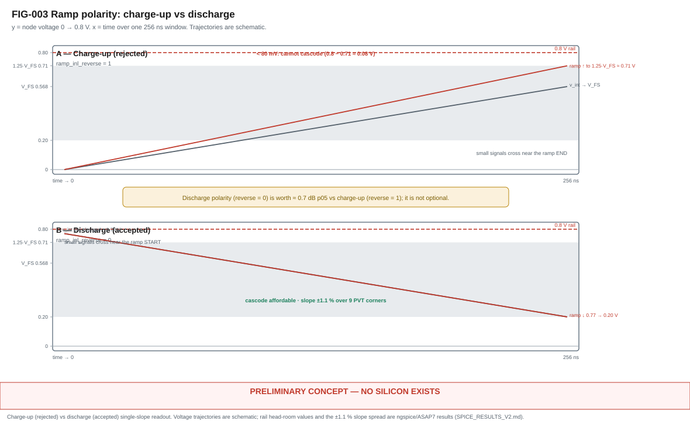
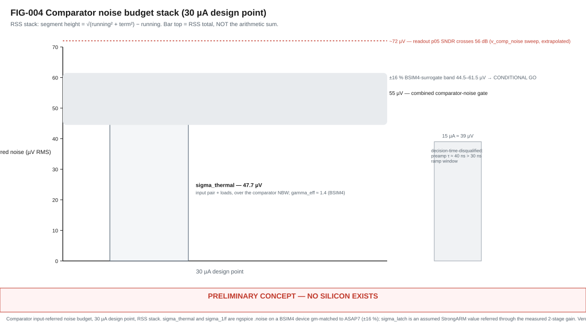
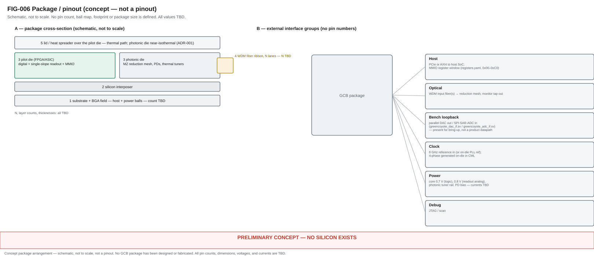
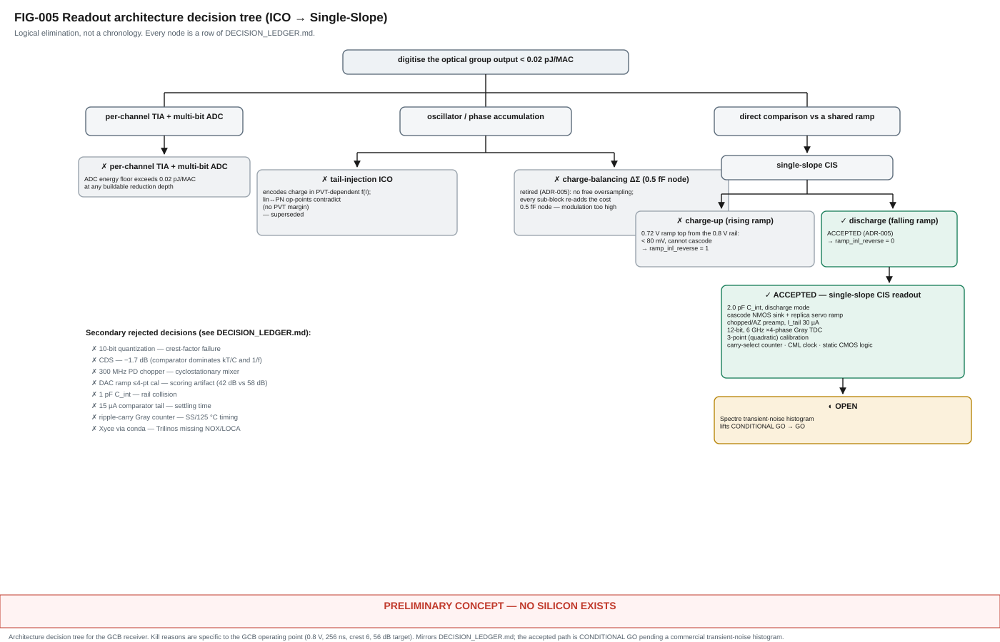

# GCB-DS-PRELIM — GreenCoyote-Bay preliminary datasheet

<!-- Provenance tags on every number:  [M] measured (ngspice/ASAP7 sim or
     Icarus)  ·  [D] derived from measured  ·  [A] assumed / design choice  ·
     [P] published-FinFET proxy  ·  [T] spec target.  Each is followed by its
     data path relative to repo root. -->

**Document status:** Phase B preliminary. Numbers are simulation / model
outputs, not silicon.

**Evidence-doc shorthand** (paths under `gcb-papers/data/readout/`):
`SR2` = `spice/SPICE_RESULTS_V2.md` · `SR3` = `spice/SPICE_RESULTS_V3.md`
(§0–§4 = first pass, §5–§11 = V3.1) · `RTL_REPORT.md` = `rtl/RTL_REPORT.md` ·
`comparator_noise.json` = `spice/comparator_noise.json`. `SR1`
(`spice/SPICE_RESULTS.md`, the rejected V1 rising-ramp NO-GO) is **not** a
source for any value below.

---

## 0. Overview & Features

> **PRELIMINARY CONCEPT — NO SILICON EXISTS — all values modeled unless marked.**

GreenCoyote-Bay (GCB / ODIN_Bridge) is a hybrid photonic–electronic inference
fabric. A RISC-V Vortex 3.0 tensor core streams Q17.14 partial products into a
cascaded **optical** carry-save reduction mesh; the analog optical result of
each output group is digitised **once** by a single-slope CIS readout; an FPGA
pilot exposes the fabric over MMIO. Source framing: **VISION** =
`gcb-wiki/product/GCB_Probable_Silicon_Product_10kft.md` (speculative, not a
spec).

Features:

- Optical carry-save reduction cell, 8-input (fan-in 4:1 vs 8:1 **open**) —
  `gcb-spec/bench_emulation_parameters.md`.
- Analog noise floor reset at every cascade stage boundary —
  `gcb-spec/docs/adr/ADR-001-cascade-adc-reset.md`.
- **Single-slope CIS readout:** discharge-mode passive integration onto
  `C_int` = 2.0 pF [A] (`SPICE_RESULTS_V2.md` §6.2); chopped + auto-zeroed
  2-stage comparator; one comparison per output.
- **Shared time-to-digital:** 12-bit carry-select Gray counter at 6 GHz [T]
  with 4-phase 24 GS/s [D] capture, serving 64 channels —
  `gcb-rtl/rtl/greencoyote_ss_tdc.sv`.
- **Per-channel 3-point (quadratic) calibration**, fixed-point, verified
  bit-exact over 10 000 [M] conversions —
  `gcb-papers/data/readout/rtl/RTL_REPORT.md` §1.
- MMIO control surface `SS_READOUT` 0xB0–0xC0 — `gcb-spec/registers.yaml`.
- Modelled readout energy **≈ 0.55 fJ/MAC** [D] vs a **< 0.02 pJ/MAC** [T]
  digital-accumulate baseline (`SR3` §2, `RTL_REPORT.md` §4).

**Verdict:** CONDITIONAL GO — the comparator-noise figure rests on a BSIM4
surrogate (±16 %); a commercial transient-noise histogram lifts it to GO
(`SPICE_RESULTS_V3.md` §9).

---

## 1. Block diagram

> **PRELIMINARY CONCEPT — NO SILICON EXISTS — all values modeled unless marked.**

Chain: photodiode → discharge integrator (`C_int`) → shared falling ramp
(cascode NMOS sink + replica servo) → chopped/AZ preamp + StrongARM latch
(gated 20 ns) → 6 GHz Gray TDC ×4-phase → 3-point calibration → `x_hat`
(Q2.16) → `SS_READOUT` registers.

<figure>
  
  <figcaption><strong>FIG-001 — System data path.</strong> Vortex tensor core →
  Q17.14 carry-save stream → optical cascade → single-slope readout → MMIO
  register block → host. Schematic, not to scale. Spec:
  <code>gcb-wiki/figures/FIG-001-system-data-path.md</code>.</figcaption>
</figure>

<figure>
  
  <figcaption><strong>FIG-002 — Readout signal chain.</strong> Photodiode →
  discharge integrator → shared falling ramp → chopped auto-zero preamp →
  StrongARM latch (analog│digital boundary) → shared 6 GHz Gray TDC → 3-point
  calibration → <code>x_hat</code> (Q2.16). Analog parameters are ngspice/ASAP7
  results; the digital back-end is bit-exact in Icarus. Spec:
  <code>gcb-wiki/figures/FIG-002-readout-signal-chain.md</code>.</figcaption>
</figure>

---

## 2. Absolute maximum ratings

> **PRELIMINARY CONCEPT — NO SILICON EXISTS — all values modeled unless marked.**

| Parameter | Min | Max | Unit | Note |
|---|---|---|---|---|
| Analog supply `V_DDA` | TBD | TBD | V | nominal 0.8 [A] |
| Logic supply `V_DDL` | TBD | TBD | V | nominal 0.7 [A] (ASAP7 rail) |
| Photonic tuner rail | TBD | TBD | V | — |
| Photodiode reverse bias | TBD | TBD | V | — |
| Junction temperature `T_J` | TBD | TBD | °C | corners simulated −40 / 27 / 125 [M] |
| Optical input power / lane | TBD | TBD | dBm | — |
| Storage temperature | TBD | TBD | °C | — |
| ESD (HBM / CDM) | TBD | TBD | V | — |

All entries **TBD** — no package, no silicon, no reliability data.

---

## 3. Electrical characteristics

> **PRELIMINARY CONCEPT — NO SILICON EXISTS — all values modeled unless marked.**

Readout comparator design point: `I_tail` = 30 µA/stage [A], `C_L` = 0.8 pF
[A], `F_chop` = 20 MHz [A], 2-stage chopped/AZ preamp + StrongARM, ASAP7 7.5T,
TT/27 °C unless noted.

**Two noise numbers are in play.** The **analytic roll-up** (γ = 1.0,
`comparator_noise.json`) gives a 30 µA total of **46 µV**. The **BSIM4 `.noise`
result** (γ_eff ≈ 1.4, `SPICE_RESULTS_V3.md` §7) gives **53 µV** — this is the
figure the CONDITIONAL GO and the ±16 % surrogate band ride on; the roll-up is
the lower-bound cross-check. Rows below quote the **BSIM4 `.noise`** values.

| Parameter | Value | Tag | Data path |
|---|---|---|---|
| Photocurrent, RMS | 0.74 µA | [T] | `gcb-spec/models/readout/ss_readout_mc.py` `I_pd_rms` |
| Photocurrent, full-scale (crest 6) | 4.45 µA | [T] | `ss_readout_mc.py` `I_pd_rms · crest` |
| Integrated full-scale charge `Q_FS` | 1.137 pC | [D] | SR2 header line |
| Integrator swing `V_FS` (on 2.0 pF) | 568 mV | [D] | SR2 header line |
| Ramp slope (9 PVT corners) | 4.18–4.22 mV/ns | [M] | `data/readout/ramp_inl/ramp_inl_meta.json` `slope_mV_ns` |
| Ramp INL, raw (best-fit line, discharge ramp) | 0.04–0.11 % FS RMS | [M] | SR2 §1b; `data/readout/ramp_inl/ramp_inl_*.csv` |
| Preamp per-stage gain (measured) | 5.3–8.9 | [M] | SR3 §1 (per-stage op-point table); §5c |
| Preamp total gain `G_tot` (two stages, `G1²`) | 28–79 (design pt 50.4) | [D] | `comparator_noise.json` `rows[*].Gtot`; SR3 §5c |
| Comparator σ_thermal (BSIM4 `.noise`, over NBW) | 47.7 µV | [D] | SR3 §7 (30 µA row) |
| BSIM4 excess-noise factor γ_eff | ≈ 1.4 | [P] | SR3 §7 (BSIM4 `.noise` fit) |
| Comparator σ_1/f, raw (BSIM4 `.noise`, 1 kHz–1 GHz) | 54.4 µV | [D],[P] | SR3 §7 (30 µA row); `K_Fn` proxy [P] |
| Comparator σ_1/f, after 20 MHz chopper | 15.6 µV | [D],[P] | SR3 §7 (30 µA row) |
| — analytic roll-up, auto-zero only (cross-check) | ≈ 43 µV | [D],[P] | `comparator_noise.json`; SR3 §7 |
| StrongARM latch, input-referred / `G_tot` | ≈ 16 µV | [A] | SR3 §7 (assumed 0.8 mV latch ÷ `G_tot`) |
| **Total input-referred comparator noise (BSIM4 `.noise`)** | **53 µV** | **[D]** | SR3 §7 (30 µA row); §9 |
| — analytic roll-up total (cross-check) | 45.8 µV | [D] | `comparator_noise.json` `rows[*].v_total_uV` |
| Comparator-noise gate | ≤ 55 µV | [T] | SR3 §9 |
| Surrogate-model uncertainty | ±16 % (44.5–61.5 µV) | [P] | SR3 §9 |
| 3σ input offset `V_os` (post OOS auto-zero) | 3.2 mV | [D] | `comparator_noise.json` `Vos_resid_3sig_mV`; SR3 §3 |
| `V_os` gate | ≤ 5 mV | [T] | SR3 §9 |
| Pelgrom coefficient `A_VT` | 2.0 mV·µm | [P] | SR3 §0 ("Assumed published-FinFET proxies") |
| Flicker coefficient `K_Fn` | 5e-11 V²·µm² | [P] | SR3 §0 |
| Readout SNDR, worst-corner p05 (at 53 µV) | 56.72 dB | [D] | SR3 §8; `data/readout/spice/mc_v2/*_spiceN53_c2.json` |
| SNDR target | ≥ 56 dB (comfortable); ≥ 53 dB (collapse knee) | [T] | `gcb-spec/docs/adr/ADR-005-*.md` (context); SR3 §9 |
| `v_comp_noise` at which readout p05 → 56 dB | ≈ 72 µV (extrapolated) | [D] | SR3 §10; `data/readout/spice/mc_v2/*_nsweep*_c2.json` |
| Comparator energy, gated 20 ns decision | 0.51 fJ/MAC | [D] | `comparator_noise.json` `E_fJ_per_MAC` (30 µA); SR3 §2 |
| Comparator energy, ungated (171 ns) | ≈ 1.7 fJ/MAC | [D] | SR3 §2 |
| Digital back-end energy | 0.039 fJ/MAC (0.056 pess.) | [D] | `RTL_REPORT.md` §4; `gcb-rtl/sim/ss_energy.py` |
| **Total readout energy** | **≈ 0.55 fJ/MAC** | **[D]** | SR3 §2 + `RTL_REPORT.md` §4 |
| Energy gate | ≤ 0.6 fJ/MAC | [T] | SR3 §9 |
| ASAP7 cap: flop / gate / Gray-dist | 0.80 / 0.30 / 6.0 fF | [P] | `RTL_REPORT.md` §4 |

Lower-noise operating points exist (`I_tail` = 15 µA → ≈ 39 µV [D], SR3 §7) but
are **decision-time-disqualified**: preamp τ ≈ 40 ns > the ≈ 30 ns ramp window,
so the crossing cannot be resolved in time (SR3 §5b).

<figure>
  
  <figcaption><strong>FIG-003 — Ramp polarity.</strong> Charge-up (rejected) vs
  discharge (accepted). A rising ramp tops out ≈ 80 mV below the 0.8 V rail and
  cannot be cascoded; the falling discharge ramp keeps its triode knee below the
  used code floor and is worth ≈ 0.7 dB p05. Rail-headroom values and the
  ±1.1 % slope spread are ngspice/ASAP7 results (`SR2`). Spec:
  <code>gcb-wiki/figures/FIG-003-ramp-polarity.md</code>.</figcaption>
</figure>

<figure>
  
  <figcaption><strong>FIG-004 — Comparator noise budget.</strong> 30 µA design
  point, RSS-stacked against the 55 µV gate. σ_thermal and σ_1/f are ngspice
  <code>.noise</code> on a BSIM4 device gm-matched to ASAP7 (±16 % band,
  shaded); σ_latch is an assumed StrongARM value referred through the measured
  2-stage gain. Readout p05 SNDR fails only at ≈ 72 µV (dotted). Spec:
  <code>gcb-wiki/figures/FIG-004-noise-budget-stack.md</code>.</figcaption>
</figure>

---

## 4. Timing

> **PRELIMINARY CONCEPT — NO SILICON EXISTS — all values modeled unless marked.**

| Parameter | Value | Tag | Data path |
|---|---|---|---|
| Observation (integration) window `T_obs` | 256 ns | [T] | `ss_readout_mc.py` `T_obs` |
| Ramp duration `T_ramp` = 2¹²/(6 GHz·4) | 170.6 ns (≈ 171) | [D] | `ss_readout_mc.py` `derived()`; RTL §5 `SS_RAMP_TIMING` |
| Counter clock `f_clk` | 6 GHz | [T] | `ss_readout_mc.py` `f_clk` |
| Clock phases → effective sample rate | 4 → 24 GS/s | [D] | RTL §2 |
| 6 GHz period | 166.7 ps | [D] | RTL §3 |
| 12-bit **ripple**-carry counter path, SS/125 °C | ≈ 195 ps → **fails** | [D] | RTL §3a; `registers.yaml` DD-001 |
| 12-bit **carry-select** counter path, SS/125 °C | ≈ 112 ps (≈ 55 ps slack) | [D] | RTL §3a |
| Per-phase capture setup budget | 25–40 ps | [D] | RTL §3b |
| Comparator power-gate window | 20 ns = 120 ticks | [A] | `SS_TDC_CTRL.GATE_WIDTH` reset 0x078 |
| Calibration pipeline latency | 3 clocks | [M] | RTL §1 |
| Conversions verified bit-exact (Icarus ↔ golden) | 10 000 | [M] | RTL §1; `sim/tb_ss_calib.sv` |
| 4-phase 6 GHz clock generation / distribution | CML island | [D] | RTL §3c; DD-001 |

---

## 5. Register map

> **PRELIMINARY CONCEPT — NO SILICON EXISTS — all values modeled unless marked.**

Auto-generated from `gcb-spec/registers.yaml` by `regen.py --target md`. Do not
hand-edit between the markers.

<!-- REGEN:BEGIN regmap -->

_Generated by `gcb-spec/regen.py --target md` from `registers.yaml` map_version **0.6.0** — 49 registers, address window 0x00–0xE4, unmapped read 0xDEADBEEF._

| Offset | Register | Domain | Access | Fields (bit range) |
|---|---|---|---|---|
| 0x00 | `PRECISION_MODE` | inference | rw | `MODE_SEL`[2:0], `NOISE_HEADROOM`[4:3], `SAT_GUARD`[6:5] |
| 0x04 | `GLOBAL_CAL` | inference | rw/rw_locked | `DARK_OFFSET`[11:0], `GAIN_TRIM_GLOBAL`[23:12], `CAL_VALID`[24], `CAL_LOCK`[25] |
| 0x08 | `CH_GAIN_TRIM_LO` | inference | rw | `TRIM_CH0`[7:0], `TRIM_CH1`[15:8], `TRIM_CH2`[23:16], `TRIM_CH3`[31:24] |
| 0x0C | `CH_GAIN_TRIM_HI` | inference | rw | `TRIM_CH4`[7:0], `TRIM_CH5`[15:8], `TRIM_CH6`[23:16], `TRIM_CH7`[31:24] |
| 0x10 | `REDUCTION_CTRL` | inference | ro/rw/w1p | `FIRE`[0], `MODE_ACTIVE`[1], `PASS_INDEX`[3:2], `QUEUE_DEPTH`[7:4], `CAL_ERR`[8], `FIRE_DONE`[9], `AUTO_FIRE`[10], `ROUND_MODE`[12:11] |
| 0x14 | `IRQ_CTRL` | inference | ro/rw/wo | `IRQ_EN`[0], `IRQ_FIRE_DONE_EN`[1], `IRQ_CAL_ERR_EN`[2], `IRQ_QUEUE_FULL_EN`[3], `IRQ_PASS_DONE_EN`[4], `IRQ_DMA_DONE_EN`[5], `IRQ_DMA_UNDERRUN_EN`[6], `IRQ_STATUS`[8], `IRQ_CLEAR`[9] |
| 0x18 | `XBAR_ROUTE_LO` | routing | rw | `XBAR_DEST0`[2:0], `XBAR_DEST1`[5:3], `XBAR_DEST2`[8:6], `XBAR_DEST3`[11:9] |
| 0x1C | `XBAR_ROUTE_HI` | routing | rw | `XBAR_DEST4`[2:0], `XBAR_DEST5`[5:3], `XBAR_DEST6`[8:6], `XBAR_DEST7`[11:9] |
| 0x20 | `XBAR_MODE_STATUS` | routing | ro/rw | `XBAR_MODE`[1:0], `XBAR_READY`[2] |
| 0x24 | `TRAIN_CTRL` | training | ro/rw | `TRAIN_MODE`[0], `DAC_FREEZE`[1], `UPDATE_PENDING`[2], `UPDATE_ACTIVE`[3], `SIDECAR_ENABLE`[4], `LORA_RANK`[7:5], `ALPHA_SCALED`[23:8] |
| 0x28 | `GRAD_UPDATE_STATUS` | training | ro | `CHANNELS_UPDATED`[15:0], `UPDATE_DONE`[16], `CHECKSUM_PASS`[17], `CHECKSUM_FAIL`[18] |
| 0x2C | `LORA_TILE_ADDR` | training | rw | `LORA_TILE_ROW`[15:0], `LORA_TILE_COL`[31:16] |
| 0x30 | `CELL_COUNT_SYNC` | training | ro/rw | `CELL_COUNT`[9:0], `CELLS_READY`[19:10], `ALL_CELLS_READY`[20], `GRAD_REDUCE_DONE`[21] |
| 0x34 | `GRAD_REDUCE_CTRL` | training | rw/w1p | `GRAD_REDUCE_EN`[0], `GRAD_REDUCE_FIRE`[1], `AUTO_GRAD_REDUCE`[2], `GRAD_SCALE`[31:8] |
| 0x38 | `SPI_CFG` | training | rw | `N_SPI_BUSES`[1:0], `SPI_CLK_DIV`[23:8] |
| 0x40 | `THERMAL_TARGET` | thermal | — | *not implemented* |
| 0x44 | `THERMISTOR_TELEM0` | thermal | — | *not implemented* |
| 0x48 | `THERMISTOR_TELEM1` | thermal | — | *not implemented* |
| 0x4C | `TEC_CTRL_STATUS` | thermal | — | *not implemented* |
| 0x50 | `THERMAL_GUARD_RAIL` | thermal | — | *not implemented* |
| 0x54 | `THERMAL_LOG` | thermal | — | *not implemented* |
| 0x58 | `THERMAL_IRQ_CTRL` | thermal | — | *not implemented* |
| 0x5C | `TEC_PID_COEFF` | thermal | — | *not implemented* |
| 0x60 | `EXEC_CTRL` | isa | ro/rw | `EXEC_START`[0], `EXEC_STOP`[1], `EXEC_RESET`[2], `EXEC_STEP`[3], `EXEC_RUNNING`[8], `EXEC_DONE`[9], `EXEC_ERROR`[10], `EXEC_PC`[23:12], `EXEC_OPCODE`[31:24] |
| 0x64 | `BRAM_WR_ADDR` | isa | rw | `BRAM_WR_ADDR`[11:0] |
| 0x68 | `BRAM_WR_DATA_LO` | isa | rw | `BRAM_WR_DATA_LO`[31:0] |
| 0x6C | `BRAM_WR_DATA_HI` | isa | rw | `BRAM_WR_DATA_HI`[31:0] |
| 0x70 | `LC_LOAD_LO` | isa | rw | `LC0`[15:0], `LC1`[31:16] |
| 0x74 | `LC_LOAD_HI` | isa | rw | `LC2`[15:0], `LC3`[31:16] |
| 0x78 | `SYNC_STATUS` | isa | ro | `SYNC_PENDING`[15:0], `SYNC_TIMEOUT`[17] |
| 0x7C | `EXEC_ERR_LOG` | isa | ro | `ERR_PC`[11:0], `ERR_OPCODE`[19:12], `ERR_CAUSE`[23:20] |
| 0x80 | `SNAPSHOT_STATUS` | snapshot | ro | `SNAPSHOT_READY`[0], `SNAPSHOT_RUNNING`[1], `SNAP_DIVERGE`[2], `ROLLBACK_ACTIVE`[3], `ROLLBACK_COMPLETE`[4], `SYSTEMIC_FAULT`[5], `RESTORE_OK`[6], `RESTORE_FAIL`[7], `SNAP_ID_LAST`[15:8], `SNAP_PC_LAST`[27:16] |
| 0x84 | `ROLLBACK_CTRL` | snapshot | ro/rw | `ROLLBACK_COUNT`[7:0], `ROLLBACK_LIMIT`[15:8], `SNAP_PC_LAST`[27:16], `FAULT_IRQ_EN`[28], `ROLLBACK_EN`[29] |
| 0x88 | `FAULT_LOG` | snapshot | ro | `FAULT_CAUSE`[3:0], `FAULT_TILE`[11:4], `FAULT_PC`[23:12], `FAULT_COUNT`[27:24], `FAULT_IRQ_EN`[28] |
| 0x8C | `SNAP_LOG_PTR` | snapshot | ro | `SNAP_LOG_BASE`[11:0], `SNAP_LOG_SIZE`[23:12], `SNAP_COUNT`[31:24] |
| 0x90 | `TASK_ALLOC_CTRL` | os | ro/rw/wo | `ACTIVE_TID`[3:0], `TARGET_TID`[7:4], `TASK_COUNT`[11:8], `ALLOC_CONFLICT`[12], `SWITCH_ACTIVE`[13], `SHUTDOWN_READY`[14], `SHUTDOWN_ACK`[15], `TID_ACTIVE_MASK`[31:16] |
| 0x94 | `TID_STATUS` | os | ro | `TID_STATE`[7:0], `TID_PRIORITY`[11:8], `TID_PC`[23:12], `TID_FAULT_COUNT`[27:24], `TID_ANCHOR_VALID`[28] |
| 0x98 | `TILE_ALLOC_MAP` | os | ro | `TILE_SELECT_RB`[8:0], `TILE_TID`[12:9], `TILE_ALLOCATED`[13] |
| 0x9C | `TILE_SELECT` | os | rw | `TILE_SELECT`[8:0] |
| 0xA0 | `RATE_LIMIT_STATUS` | os | ro | `BW_TOKENS_REMAIN`[15:0], `BW_QUOTA_MBPS`[31:16] |
| 0xA4 | `SCHED_STATS` | os | ro | `SCHED_CYCLES`[31:0] |
| 0xA8 | `SHUTDOWN_CTRL` | os | ro/rw | `SHUTDOWN_INIT`[0], `EMERGENCY_SHUTDOWN`[1], `FLUSH_OMBS`[2], `IRQ_BEFORE_POWER`[3], `SHUTDOWN_TIMEOUT_MS`[15:4], `POWER_OFF_ASSERT`[16], `ALL_TIDS_SNAPSHOTTED`[17], `OMB_FLUSH_DONE`[18] |
| 0xAC | `BLK_SCALE_STATUS` | inference | ro | `BLK_EXP`[4:0], `CLAMP`[5], `LANE_BIAS_N`[9:6] |
| 0xB0 | `SS_TDC_CTRL` | inference | rw/w1p | `CNT_EN`[0], `CLEAR_ALL`[1], `GATE_START`[15:4], `GATE_WIDTH`[27:16] |
| 0xB4 | `SS_CAL_IDX` | inference | rw | `CH`[5:0], `COEF_SEL`[7:6] |
| 0xB8 | `SS_CAL_DATA` | inference | rw | `SS_CAL_DATA`[31:0] |
| 0xBC | `SS_RAMP_TIMING` | inference | rw | `T_RAMP`[11:0], `RAMP_RST_OFS`[23:12], `SLOPE_TRIM`[31:24] |
| 0xC0 | `SS_TDC_STATUS` | inference | ro | `RUNNING`[0], `OVERFLOW`[1], `FIRED_COUNT`[9:4], `LAST_CH`[15:10], `CAL_IDX_WRAP`[16] |
| 0xC4 | `DMA_CTRL` | dma | rw/w1p | `EN`[0], `ARM`[1], `ABORT`[2], `RING_SRC`[3], `ARCACHE`[7:4], `ARPROT`[10:8], `WINDOW_W`[27:16] |
| 0xC8 | `DMA_DESC_RING_BASE_LO` | dma | rw | `RING_BASE_LO`[31:0] |
| 0xCC | `DMA_DESC_RING_BASE_HI` | dma | rw | `RING_BASE_HI`[15:0], `RING_SZ_LOG2`[20:16] |
| 0xD0 | `DMA_DESC_HEAD` | dma | ro | `HEAD`[15:0] |
| 0xD4 | `DMA_DESC_TAIL` | dma | rw | `TAIL`[15:0] |
| 0xD8 | `DMA_DESC_WINDOW` | dma | wo | `DMA_DESC_WINDOW`[31:0] |
| 0xDC | `DMA_WEIGHT_TILE_LO` | dma | rw | `WT_BASE_LO`[31:0] |
| 0xE0 | `DMA_WEIGHT_TILE_HI` | dma | rw | `WT_BASE_HI`[15:0], `WT_SHAPE`[19:16] |
| 0xE4 | `DMA_STATUS` | dma | ro | `RUNNING`[0], `ARMED`[1], `WT_LOADED`[2], `UNDERRUN`[3], `DESC_ERR`[4], `ROWS_BUFFERED`[19:8], `LAST_DESC_ID`[31:20] |

<!-- REGEN:END regmap -->

---

## 6. Package / pinout (concept)

> **PRELIMINARY CONCEPT — NO SILICON EXISTS — all values modeled unless marked.**

Concept-level co-packaged optics: pilot die + photonic die on a silicon
interposer, WDM fiber attach at the photonic-die edge, bench DAC/ADC loopback
pins for bring-up only. **No pin count, ball map, footprint, or package size is
defined.** Every dimension, voltage tolerance and current is **TBD**.

<figure>
  
  <figcaption><strong>FIG-006 — Package / pinout (concept).</strong> Left: a
  schematic cross-section stack (substrate + BGA → interposer → pilot die +
  photonic die → fiber attach → lid). Right: the external interface groups
  (host, optical, bench loopback, clock, power, debug). Not a pinout — no pin
  count, ball map, footprint, or size is implied. Spec:
  <code>gcb-wiki/figures/FIG-006-package-pinout.md</code>.</figcaption>
</figure>

---

## 7. Revision history

> **PRELIMINARY CONCEPT — NO SILICON EXISTS — all values modeled unless marked.**

| Rev | Date | Change |
|---|---|---|
| PRELIM-A | 2026-09-07 | Phase B initial issue. Overview, block-diagram pointer, absolute-max stub (all TBD), electrical characteristics from the SPICE roll-up (`SR3`), timing, `regen.py`-injected register map, concept package pointer. Verdict CONDITIONAL GO. |
| PRELIM-A rev.1 | 2026-09-07 | Rendering review: (a) added the `SR1/SR2/SR3` shorthand legend; (b) split the comparator-noise rows into the BSIM4 `.noise` figures (47.7 / 54.4 / 15.6 / **53 µV**, the CONDITIONAL-GO basis) and the analytic roll-up cross-check (`comparator_noise.json`, γ = 1.0: σ_thermal 40.8, σ_1/f AZ-only ≈ 43 / post-chop 12.1, latch/`G_tot` 15.9, **total 45.8 µV**) — earlier rows conflated the two and mis-cited `comparator_noise.json` for the 53 µV total; (c) removed a row that quoted the rejected V1 rising-ramp post-cal INL (`SR1`) as if it were the V2 discharge ramp; (d) re-pointed the SNDR-target row from an uncommitted script to `ADR-005`; (e) `regen.py emit_md` now writes literal en/em-dashes instead of HTML entities. No value that survived review changed. |
| PRELIM-A rev.2 | 2026-09-07 | Phase C: embedded the rendered SVGs (FIG-001/002 in §1, FIG-003/004 in §3, FIG-006 in §6, FIG-005 in Appendix A) in place of the "no rendered image exists yet" pointers; each figure carries its own burned-in "PRELIMINARY CONCEPT — NO SILICON EXISTS" strip. Added the PDF build path (`gcb-papers/scripts/build_pdfs.sh` → `GCB_Preliminary_Datasheet.pdf`). No datasheet value changed. |

---

## Appendix A — Architecture decision tree

> **PRELIMINARY CONCEPT — NO SILICON EXISTS — all values modeled unless marked.**

<figure>
  
  <figcaption><strong>FIG-005 — Readout architecture decision tree.</strong>
  From the oscillator / ΔΣ encodings that were falsified on PVT and energy
  grounds, to the discharge-mode single-slope CIS readout that was accepted
  (`ADR-005`). Kill reasons are specific to the GCB operating point (0.8 V,
  256 ns window, crest 6, 56 dB target); the accepted path is CONDITIONAL GO
  pending a commercial transient-noise histogram. Spec:
  <code>gcb-wiki/figures/FIG-005-decision-tree.md</code>.</figcaption>
</figure>
