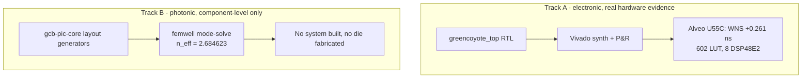

# Lens 1: Silicon & Physical Design Architect

> **Absorbs:** Electrical Engineer, Photonics Professor, Math
> Professor, Chip Manufacturer / Tiny Tapeout, Silicon Tester.
>
> **Not the source of truth.** `gcb-spec` is. This lens is a
> consolidated entry point — for the full derivation behind any claim
> here, follow the link to its source saga
> ([`sagas/`](https://github.com/jagreen03/gcb-wiki/blob/main/sagas/README.md)), the shared
> [manufacturing/test appendix](../appendices/manufacturing-pdk.md),
> or the
> [silicon & package detail appendix](../appendices/silicon-and-package-detail.md)
> — the last one exists specifically to untangle **which parts below
> are electronic and which are photonic**, chip by chip — rather than
> expecting the full depth duplicated on this page (SSOT).
>
> **Use the depth toggle above.** Executive: what's real, in one
> screen. System: the architecture and physics. Foundry: full
> citations, raw numbers, and — explicitly — what has **not** been
> built yet (tapeout, packaging, silicon test).

<!-- depth:executive -->
## Executive summary

This program has two tracks with very different physical maturity.
**Track A** (the electronic baseline) has a real, measured result: an
actual FPGA place-and-route, timing-closed, on a commercial part
(AMD Alveo U55C). **Track B** (the photonic tensor fabric) has real
component-level engineering — a verified waveguide simulation, real
photonic layout generators — but no system has been built or measured.
**Neither track has been through a real ASIC tapeout, and no chip
packaging or silicon test program exists anywhere in this program.**
That last sentence is not a caveat to skim past — see the Foundry tier
below for the full, checked list of what specifically hasn't started.

**If you're not sure which parts of "the silicon" are ordinary
electronics and which are photonics** — a genuinely common point of
confusion, since this system is both — the
[silicon & package detail appendix](../appendices/silicon-and-package-detail.md)
tags every real component by domain, chip by chip, before going deeper
than this lens does.
<!-- /depth -->

<!-- depth:system -->
## System: two tracks, two mechanisms

| | Track A — "GCB/ODIN_Bridge" | Track B — "GCB Photonic QAM Accelerator" |
|---|---|---|
| Mechanism | Single-wavelength power-summing | Balanced-homodyne complex multiply, $4\mathrm{Re}(AB^*)$ |
| Physical maturity | **Real Vivado P&R** — see below | RTL + layout only |
| Deployment target | Existing FPGA hardware (no new fab needed) | Long-horizon, would eventually need photonic fabrication |

The core physics: two optical fields $A,B$ combined on a balanced
mixer feeding two photodiodes gives
$|A+B|^2 - |A-B|^2 = 4\mathrm{Re}(AB^*)$ — a real complex multiply as a
side effect of interference, implemented (not just theorized) in
[`gcb-pic-core/qam_reduction_cell.py`](https://github.com/jagreen03/gcb-pic-core/blob/main/qam_reduction_cell.py).
Every stage's transfer function is the standard Mach-Zehnder matrix
$M(\lambda) = C_2 \cdot P(\Delta L,\lambda) \cdot C_1$. Full derivation:
[`sagas/saga-02-math-prof.md`](../sagas/saga-02-math-prof.md).

The waveguide mode itself is solved, not assumed:
$n_{\text{eff}} = 2.684623$ for a 500 nm × 220 nm silicon strip
waveguide at 1.31 µm, via a real `femwell` finite-element solve,
reproduced byte-identically across two runs. Full physics:
[`sagas/saga-03-photonics-prof.md`](../sagas/saga-03-photonics-prof.md).
<!-- /depth -->

<!-- depth:foundry -->
## Foundry: full citations, and what has not been built

**Real, verified physical-design results** (RTL → Vivado/OpenROAD,
digital logic only): WNS = +0.261 ns / 602 LUT / 8 DSP48E2 on
`xcu55c-fsvh2892-2L-e`; a complete OpenROAD ASAP7 flow to GDS on
`gcb_tensor_a_operand_pd` (0 DRC); a real, corrected SRAM macro
aspect-ratio fix. Full numbers, sources, and the FakeRAM power-number
caveat: [**manufacturing appendix, Part 1**](../appendices/manufacturing-pdk.md#part-1-what-is-real-digital-physical-design-asap7-openroad).

**What "Chip Manufacturer / Tiny Tapeout" and "Silicon Tester" would
need, and does not have today:** ASAP7 is a predictive academic PDK —
no real foundry accepts it, so none of the physical-design work above
is tapeout-ready as-is. There is no package model, no wafer-probe test
plan, no ATE test-vector set, and no silicon has ever been fabricated
for this program. This is not a roadmap gap being minimized — it is
the actual, checked, current state. Full gap list:
[**manufacturing appendix, Part 2**](../appendices/manufacturing-pdk.md#part-2-what-is-not-yet-real-tapeout-package-pcb-board-physical-test).

**Register map, for RTL-level integration work:** `registers.yaml`
(map_version 0.6.0, 49 registers, 0x00–0xE4) is the one source, feeding
five generated consumers via `regen.py` — never hand-edit a generated
file. A real, recently-fixed example of hand-RTL drifting from the spec
(`IRQ_CTRL[5]`/`[6]`, `GCB-040`) is worked through in
[`sagas/saga-04-electrical-eng.md`](../sagas/saga-04-electrical-eng.md).
<!-- /depth -->
