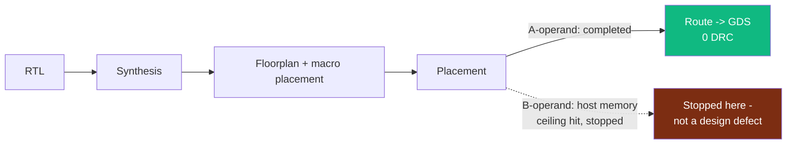

# Lens 2: Systems, Packaging & Board Engineer

> **Absorbs:** Mechanical Engineer, PCB Manufacturer, Board Assembler,
> Board / System Tester.
>
> **Not the source of truth.** This lens is a consolidated entry point
> — full depth lives in [`sagas/saga-05-mechanical-eng.md`](../sagas/saga-05-mechanical-eng.md)
> and the shared [manufacturing/test appendix](../appendices/manufacturing-pdk.md)
> (SSOT — read once there, cited here, not re-derived).
>
> **Use the depth toggle above.**

<!-- depth:executive -->
## Executive summary

This program has real digital-logic footprint numbers (from real EDA
tool output) and real RTL-simulation test evidence. **It has no PCB,
no board, no package, and no assembled hardware of its own** — the
FPGA results elsewhere in this program run on a commercial,
off-the-shelf card (AMD Alveo U55C), not a GCB-designed board. If your
role is PCB design, board assembly, or board-level test, the honest
starting point is: that work has not begun.
<!-- /depth -->

<!-- depth:system -->
## System: what physical footprint data exists

Real digital-logic die/macro footprints exist (down to a specific,
previously-broken-then-fixed SRAM macro aspect ratio) — but these are
**silicon-die-level** numbers from a predictive academic PDK, not
board- or enclosure-level dimensions. There is no chassis, PCB, or
enclosure design to size against them yet; the concept-art chassis
renders in `gcb-spec/concepts/` are explicitly labeled AI-generated
illustration, not CAD, and must not be used for layout or thermal work
— see [`sagas/saga-05-mechanical-eng.md`](../sagas/saga-05-mechanical-eng.md)
for the full figures and that warning in context.

**Board/system test today** means the RTL simulation regressions
listed in the appendix (`tb_dma_integration`, `tb_cs_fifo_path`, the
single-slope testbenches) — real, passing, but exercising simulated
RTL, not an assembled board.
<!-- /depth -->

<!-- depth:foundry -->
## Foundry: real numbers, and the PCB/board/test gap in full

**Real:** die area ~80,047 µm² (A-operand, complete flow); ~1.41 mm²
synthesis-stage footprint for the B-operand (62.2× scale-up, matching
its 64× larger operand almost exactly); per-macro SRAM footprint
132.81 µm × 331.8 µm after a real aspect-ratio defect fix (the naive
generation produced an unusable ~635:1 aspect ratio). **Not real:**
the reported 87.45 W power figure — a FakeRAM2.0 placeholder, not a
thermal design input. Full table and sourcing:
[**manufacturing appendix, Part 1**](../appendices/manufacturing-pdk.md#part-1-what-is-real-digital-physical-design-asap7-openroad).

**PCB Manufacturer / Board Assembler / Board-System Tester — the
direct, checked answer:** no PCB layer stackup, no PCB DRC rules, no
package-to-board pinout, no bond-wire/package parasitic model, and no
board assembly or bring-up has happened for this program. The Alveo
U55C card used for Track A's real FPGA results is COTS hardware, not a
GCB board design. Full gap list and the honest ordering of what would
need to happen first (commercial PDK → tapeout → package → PCB → board
→ board test), none of it started yet:
[**manufacturing appendix, Part 2**](../appendices/manufacturing-pdk.md#part-2-what-is-not-yet-real-tapeout-package-pcb-board-physical-test).

**Real test evidence, at the RTL level, table + citations:**
[**manufacturing appendix, "Digital test evidence that actually exists"**](../appendices/manufacturing-pdk.md#digital-test-evidence-that-actually-exists).
<!-- /depth -->
