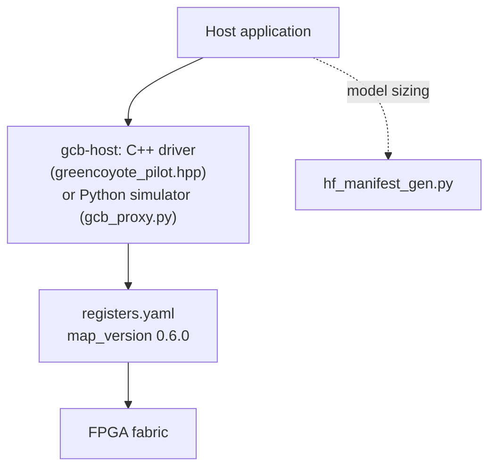
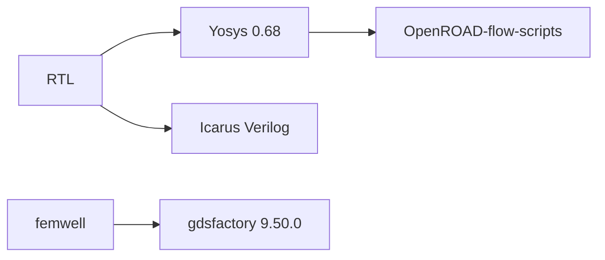

# Lens 3: Software, API & Developer Lead

> **Absorbs:** Corporate Contacts, Students & Researchers, and
> software engineers generally.
>
> **Not the source of truth.** `gcb-spec/registers.yaml` is. Full depth:
> [`sagas/saga-07-corporate.md`](../sagas/saga-07-corporate.md) (the API
> stack), [`sagas/saga-08-student.md`](../sagas/saga-08-student.md)
> (the runnable toolchain path), and
> [`appendices/student-tooling-installation.md`](../appendices/student-tooling-installation.md)
> (installing that toolchain — a base reference, since doing it all at
> once is genuinely complex).
>
> **Use the depth toggle above.**

<!-- depth:executive -->
## Executive summary

There is a real, working host-software stack — a C++ driver, a Python
register simulator, and a model-capacity-negotiation tool — that
compiles and runs today, independent of whether real FPGA hardware is
attached. There is also a fully runnable open-source EDA/photonics
toolchain path anyone can reproduce locally, with no license fees.
<!-- /depth -->

<!-- depth:system -->
## System: the API stack and the tool pipeline

The driver and simulator are real and independently re-verified this
session (a live compile, a live register-map cross-check across five
generated targets). The toolchain path (Yosys → OpenROAD, femwell →
gdsfactory, Icarus regressions) is exactly what this program itself
uses — running it yourself reproduces the same evidence cited
elsewhere in this wiki, not a simplified teaching version of it.
<!-- /depth -->

<!-- depth:foundry -->
## Foundry: full API surface and a worked integration-risk example

**`greencoyote_pilot.hpp`** — ~800-line header-only C++ API, XRT (real
Alveo hardware) or `/dev/mem` fallback. **`gcb_proxy.py`** — a
self-checking Python MMIO register simulator (confirmed, by direct
code read, to contain zero FastAPI code despite an old, now-corrected
README claim). **`hf_manifest_gen.py`** — a real 725-line tool, tested
this session against synthetic HuggingFace configs: correctly rejects
an oversized model, correctly degrades one that fits with headroom.
Full detail: [`sagas/saga-07-corporate.md`](../sagas/saga-07-corporate.md).

**A real, worked example of the maintenance model:** `registers.yaml`
added two interrupt-enable bits in `map_version 0.6.0`; the hand-written
RTL decoder *and* the C++ driver's convenience helper both lagged
behind that addition until found (via the RTL's own honest `// TODO`)
and fixed in both places this session, verified by recompiling and
re-running the existing regression — not assumed correct by
inspection. Worked through in full in
[`sagas/saga-04-electrical-eng.md`](../sagas/saga-04-electrical-eng.md)
and [`sagas/saga-07-corporate.md`](../sagas/saga-07-corporate.md).

**Runnable toolchain, exact versions confirmed this session:** Yosys
0.68, OpenROAD-flow-scripts against ASAP7, Icarus Verilog, `femwell`
0.1.12, `gdsfactory` 9.50.0 (each version checked via real tool
output, not a requirements file assumed current). Step-by-step path:
[`sagas/saga-08-student.md`](../sagas/saga-08-student.md).
<!-- /depth -->
