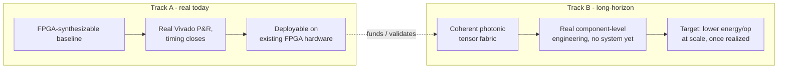

# Lens 4: Strategic & General Audience Partner

> **Absorbs:** The Neighbor, Business Investor.
>
> **Not the source of truth, and not legal or financial advice.** Full
> depth: [`sagas/saga-01-neighbor.md`](../sagas/saga-01-neighbor.md) and
> [`sagas/saga-06-investor.md`](../sagas/saga-06-investor.md).
>
> **Use the depth toggle above.**

<!-- depth:executive -->
## Executive summary

GreenCoyote-Bay replaces one specific, expensive step in AI computation
— adding up huge lists of numbers — with light, which can combine on
its own with no wires and no waiting. The program has two tracks at
very different maturity: a **real, measured, working electronic
baseline today**, and a **long-horizon photonic goal** that is real at
the component level but not yet built as a system.
<!-- /depth -->

<!-- depth:system -->
## System: the two-track shape

Track A doesn't need Track B to succeed to have standalone value — it's
a real accelerator architecture on existing, commercially available
FPGA silicon. Track B is the ambitious bet, honestly staged rather than
oversold: real waveguide physics, real layout generators, no
fabricated photonic hardware yet.
<!-- /depth -->

<!-- depth:foundry -->
## Foundry: de-risking detail, and a licensing flag that matters

De-risking points, in full: [`sagas/saga-06-investor.md`](../sagas/saga-06-investor.md).
The plain-language "streaming vs. balloon" framing, in full:
[`sagas/saga-01-neighbor.md`](../sagas/saga-01-neighbor.md).

**⚠ Licensing — do not assert a specific model without checking.** An
earlier draft of this program's materials described an "Apache 2.0
open-source foundry" strategy. Checked directly, twice, in this
session: the only `LICENSE` file anywhere in the program's repositories
(`gcb-grants/LICENSE.md`) states **"All rights reserved."** No core
repository (`gcb-spec`, `gcb-rtl`, `gcb-host`, etc.) carries a license
file of any kind. An open-source commercialization model may well be
the intended future direction — that is the Architect's decision to
make and state explicitly, and this page deliberately does not assume
it on their behalf.
<!-- /depth -->
