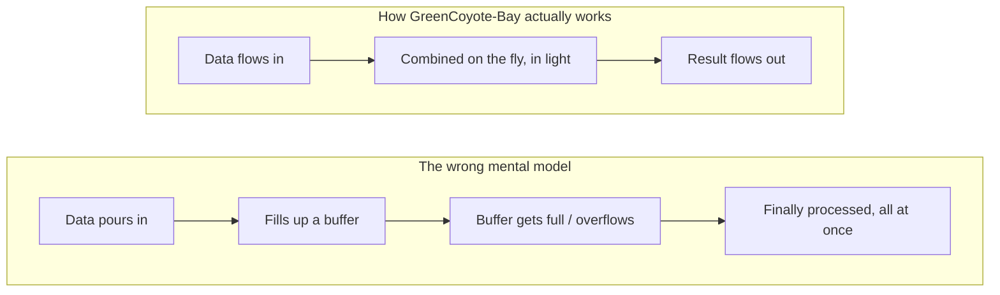

# The Neighbor's Guide to GreenCoyote-Bay

> **Who this is for:** someone with no engineering background who just
> wants to understand, in plain words, what this project actually *is*
> and why anyone would bother.
>
> **Not the source of truth.** This is a friendly retelling. The real,
> precise specification lives in [`gcb-spec`](https://github.com/jagreen03/gcb-spec) — if
> anything here ever disagrees with that, the spec is right and this
> page needs fixing, not the other way around.

## What problem are we even solving?

Big AI models — the kind that write text or answer questions — spend
most of their time doing one very boring thing over and over:
multiplying huge lists of numbers together and adding up the results.
Today, that adding-up happens over ordinary copper wires inside a
computer chip, the same way it has for seventy years.

**GreenCoyote-Bay's idea: do the *adding up* part with light instead of
wires.** Light beams can overlap and combine on their own, instantly,
with no wire, no clock tick, no waiting. If you can get the numbers
*into* light and back *out* of light cheaply enough, the addition
itself becomes almost free.

## Streaming water, not filling balloons

Here's the mental picture that matters most:

- **The wrong way to think about a computer chip:** a balloon. You pump
  data in, it stretches, it fills up, and only once it's *full* do you
  get to use what's inside. If you pump too fast, it pops. If you pump
  too slow, nothing happens for a while.
- **The way this chip is actually built to work:** a pipe with water
  running through it continuously. Data flows in one end in a steady
  stream, gets combined *while it flows*, and comes out the other end
  already finished — never piling up, never waiting, never popping.

That "streaming, not storing" idea shows up everywhere in this
program's actual engineering: the compute core is built so that a
result is ready every single clock tick, with (per the project's own
measurements) **zero stalls** — nothing ever backs up waiting for
something else to finish.

## Two versions of the idea, at two different stages of "real"

This matters a lot for honesty, so it's worth saying plainly: **this
program is really two related efforts, at very different levels of
maturity.**

1. **The part that is built and proven today** uses ordinary
   electronics (a commercial FPGA chip) and has real, measured results:
   it has actually been placed onto a real chip design and timed with
   real tools — not a guess, an actual measurement.
2. **The part that uses light to do the math** is the long-term,
   ambitious goal. Pieces of it are real and have been individually
   tested (a real optical waveguide shape was simulated and its
   physical behavior calculated), but the *whole* light-based chip has
   not been built or tested as a complete system yet. That's normal and
   expected at this stage — it's honestly labeled as such throughout
   the project's own records, not oversold.

## Why bother?

Because electrical wires get slower, hotter, and more expensive to run
faster, while light beams don't have those same limits for this kind of
job. If the light-based version works at full scale, the "adding up
numbers" step — which is most of what these AI systems spend their time
doing — could become dramatically cheaper and faster than it is today.

## Where to go next

- Curious about the actual math? → [`saga-02-math-prof.md`](saga-02-math-prof.md)
- Curious about the physics of the light part? → [`saga-03-photonics-prof.md`](saga-03-photonics-prof.md)
- Curious what's actually *built*, today, on real hardware? →
  [`saga-04-electrical-eng.md`](saga-04-electrical-eng.md)
