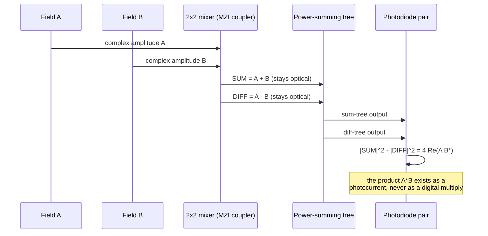

# The Mathematician's Path Through GreenCoyote-Bay

> **Who this is for:** someone comfortable with linear algebra and
> complex analysis who wants the actual equations, not metaphors.
>
> **Not the source of truth.** The equations below are restatements of
> what is implemented in real, checked-in code. The code and the
> register/ADR specification in [`gcb-spec`](https://github.com/jagreen03/gcb-spec) are
> authoritative; if this page and the code ever disagree, trust the
> code and flag this page.

## The central trick: multiplication by interference, not by logic gates

Two complex optical field amplitudes, $A$ and $B$, are combined on a
balanced photonic mixer (a 2x2 coupler feeding two photodiodes). The
photodiodes are square-law detectors — each one reports $|\cdot|^2$ of
whatever field amplitude arrives at it, not the field itself. If the
mixer forms $A+B$ on one photodiode and $A-B$ on the other, then:

$$|A+B|^2 - |A-B|^2 = 4\,\mathrm{Re}(A B^{*})$$

This is not a schematic simplification — it is the literal comment and
implemented identity in
[`gcb-pic-core/qam_reduction_cell.py`](https://github.com/jagreen03/gcb-pic-core/blob/main/qam_reduction_cell.py):
*"square-law photodiodes extract $|A+B|^2-|A-B|^2 = 4\mathrm{Re}(AB^*)$,
the physical multiply."* **The multiplication of two complex numbers
happens as a side effect of interference, with no digital multiplier
circuit involved.** The photodiode current *is* the product (up to the
constant factor of 4 and the detector's responsivity).

The real implementation keeps the multiply stage's SUM and DIFF outputs
**optical** (no photodiodes at that stage), feeding both into separate
$n$-input power-summing trees before the final photodiode pair —
`multiply_tap()` × $n$ lanes into two `power_tree()` instances, per
[`qam_reduction_cell.py`](https://github.com/jagreen03/gcb-pic-core/blob/main/qam_reduction_cell.py).
This reorders the $\sum_k 4\mathrm{Re}(A_k B_k^{*})$ contraction so the
summation over $k$ also happens optically, not just the multiply.

## The building block: the Mach-Zehnder transfer matrix

Every directional-coupler + phase-delay + directional-coupler unit
(the textbook Mach-Zehnder interferometer) is a $2\times 2$ unitary
transfer matrix:

$$M(\lambda) = C_2 \cdot P(\Delta L, \lambda) \cdot C_1$$

where $C_1, C_2$ are the (typically $50/50$) directional-coupler
matrices and

$$P(\Delta L, \lambda) = \mathrm{diag}\!\left(1,\; e^{j\,\Delta\phi(\lambda)}\right), \qquad \Delta\phi(\lambda) = \beta(\lambda)\,\Delta L$$

with $\beta(\lambda) = \frac{2\pi}{\lambda} n_{\text{eff}}(\lambda)$ the
propagation constant of the waveguide mode (see
[`saga-03-photonics-prof.md`](saga-03-photonics-prof.md) for where
$n_{\text{eff}}$ itself comes from — it is not assumed, it is solved
for). Cascading $N$ such stages, as in a binary combiner tree, composes
$N$ of these matrices; the program's
[`gcb-pic-core/wdm_combiner_tree.py`](https://github.com/jagreen03/gcb-pic-core/blob/main/wdm_combiner_tree.py)
and [`mmi_power_tree.py`](https://github.com/jagreen03/gcb-pic-core/blob/main/mmi_power_tree.py) build
exactly this kind of binary tree in layout form, at $n=8$ (the Phase-I
bench cell size) and $n=16$ (the Phase-II integrated-array target,
`N_INPUTS_PHASE2` in that file, locked against
`gcb-spec/docs/optical_geometry_spec.md`).

## Two different "16"s — a trap this program caught itself falling into

A genuine, documented hazard worth knowing as a mathematician: this
program has **two independently-derived parameters that both happen to
equal 16**, for unrelated reasons, and an earlier pass conflated them
before catching the error:

- $K_{\max}=16$ in the DWDM transport RTL — a **balanced-homodyne
  lane count**, sized by SNR budget.
- $L_{\text{CONTRACT}}=16$ in the optical geometry spec — a
  **power-summing contraction width**, sized by DAC cadence.

Numerically equal, mechanistically unrelated. If you are ever handed a
"16" from this program, ask which of the two it is before using it in
a derivation.

## Simulation-level verification

[`sim/optical_mesh_dpi.cpp`](https://github.com/jagreen03/gcb-photonic-qam-v2/blob/main/sim/optical_mesh_dpi.cpp)
(present, near-identically, in both `gcb-photonic-qam-v2` and
`gcb-wdm-transceiver`) is the DPI-C numerical model a cocotb/Verilator
testbench calls into to emulate the optical mesh's transfer-matrix
behavior during RTL simulation — this is how the digital-logic
regressions exercise realistic optical math without needing a real
photonic device on the bench.

## Epistemic status, stated plainly

The transfer-matrix algebra above is standard photonics and not in
question. What *is* honestly staged: the $4\mathrm{Re}(AB^*)$ multiply
cell and the combiner-tree layouts are **RTL + layout, digitally/
geometrically checked**, not yet measured on a real photonic chip —
see [`saga-03-photonics-prof.md`](saga-03-photonics-prof.md) for the
exact evidence tier on each claim.
