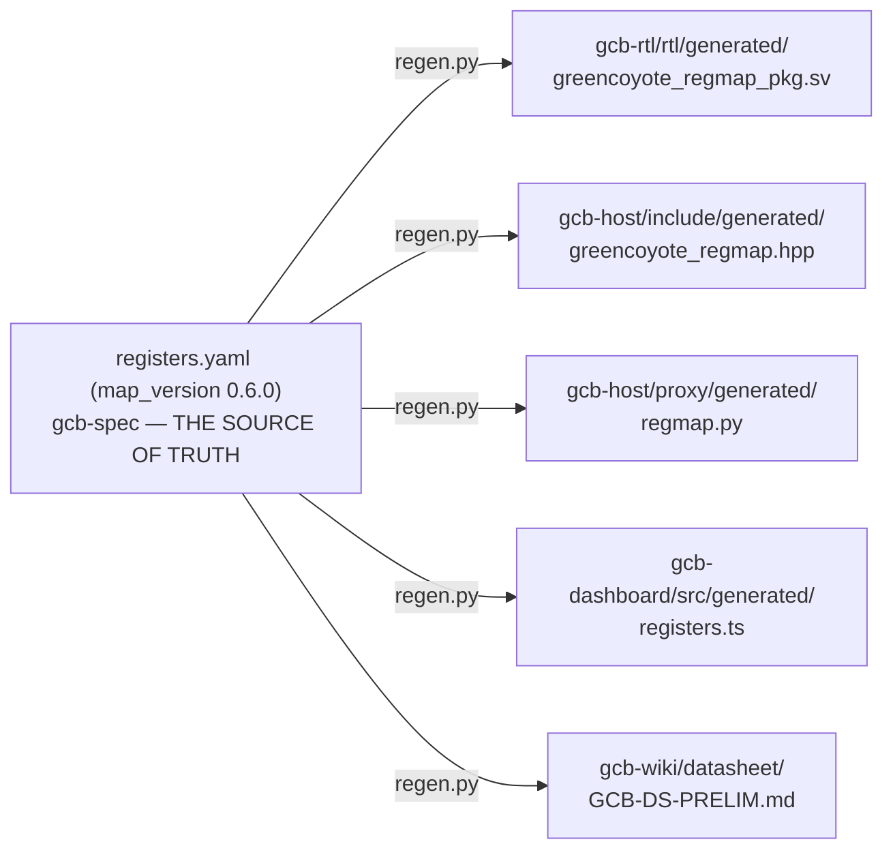

# The Electrical Engineer's Path Through GreenCoyote-Bay

> **Who this is for:** someone who wants real timing numbers, real
> register maps, and real toolchain output — not renderings.
>
> **Not the source of truth.** `gcb-spec/registers.yaml` +
> `gcb-spec/docs/adr/` are. Every number below is cited to a real,
> checked-in report file, not transcribed from memory.

## `greencoyote_top` — real Vivado place-and-route, not a simulation guess

`gcb-rtl/rtl/greencoyote_top.sv` has an actual post-route Vivado 2024.2
checkpoint (`gcb-rtl/results/post_route_baseline/post_route.dcp`)
targeting a named, real FPGA part:

| Metric | Value | Source |
|---|---|---|
| Device | `xcu55c-fsvh2892-2L-e` (AMD Alveo U55C), out-of-context mode | `utilization_route.rpt` |
| Worst setup slack | **+0.261 ns** (MET, 0 failing endpoints) | `timing_route.rpt` |
| Worst hold slack | +0.043 ns (MET) | `timing_route.rpt` |
| CLB LUTs | 602 / 1,303,680 (0.05%) | `utilization_route.rpt` |
| DSP48E2 | 8 | `utilization_route.rpt` |

This is genuinely **synthesized, placed, and routed** for a named part
— a materially higher evidence tier than "RTL, digitally simulated."
`gcb-host`'s own C++ driver
([`greencoyote_pilot.hpp`](../../gcb-host/include/greencoyote_pilot.hpp))
opens an XRT IP literally named `"greencoyote_top"`, confirming the two
repos agree on what they're talking to.

## The register map — one source, five generated consumers

**Never hand-edit any of the four generated targets** — `registers.yaml`
is the only writer, via `regen.py`. This session independently verified
all five outputs agree on `map_version 0.6.0`, register count (49), and
address window (`0x00`–`0xE4`) by direct inspection, not by trusting the
claim.

`greencoyote_pilot_regs.sv` (the hand-written register-decode module
that *consumes* the generated package — it is not itself generated, and
must be manually kept in sync when `registers.yaml` changes) is where a
real, recently-found-and-fixed gap of exactly this kind lived: `IRQ_CTRL`
bits 5/6 (`IRQ_DMA_DONE_EN`/`IRQ_DMA_UNDERRUN_EN`, added in
`map_version 0.6.0`) were defined in the spec and the generated package,
but never implemented in the hand-written decode — `greencoyote_top.sv`
hardcoded both enables to `1'b1` instead, with its own honest
`// TODO: hand RTL predates map 0.6.0` comment. Fixed, both directions
(RTL *and* the C++ driver's `enable_irq()` helper, which had the
matching gap), verified by re-running the existing cocotb/Icarus
regression — a real, recent, concrete example of the kind of spec-vs-RTL
drift that a hand-maintained register block is exposed to.

## Two receivers, two different programs, not two competing designs for one role

A genuinely easy trap: **ADR-005's single-slope CIS readout** and
**`gcb-analog-rx`'s switched-charge integrator** look like alternatives
for the same job. They are not — they belong to the two different
tracks in `saga-03-photonics-prof.md`'s table, each with its own real
numbers:

| | ADR-005 (Track A) | `gcb-analog-rx` (Track B) |
|---|---|---|
| Topology | Single-slope, discharge-mode, shared 6 GHz Gray-counter TDC | Switched-charge integrator, flash/comparator back-end |
| Status | `CONDITIONAL GO` (SPICE, ASAP7 academic PDK) | Phase I baseline (Architect disposition, `TKT-031`) |
| Comparator noise | 53 µV (±16% BSIM4-surrogate band) | — (different front-end entirely) |
| SNDR / energy | 56 dB SNDR, 0.55 fJ/MAC total | — |

ADR-005's digital back-end (`greencoyote_ss_tdc.sv`/`greencoyote_ss_calib.sv`)
is itself a real, **10,000/10,000 bit-exact**-verified-against-a-Python-
golden-model RTL block — but, found and reported this session
(`GCB-041`), it is **not instantiated anywhere in `greencoyote_top.sv`**.
It exists, and is rigorously proven, purely standalone — consistent with
it being the Phase II (silicon-target) backend, not the currently-active
Phase I bench path (which uses `greencoyote_adc_if`/`greencoyote_dac_if`
instead, genuinely integrated). Don't present this as "wired in" without
that caveat.

## Epistemic status, stated plainly

Everything in the first two sections is `PROVEN` by direct tool output
(Vivado, or a five-way generated-file cross-check) — the strongest
evidence tier this program has anywhere. The receiver comparison is
`SPICE-CHARACTERIZED / CONDITIONAL GO` for ADR-005's analog front-end,
and `RTL, bit-exact-simulated, not integrated` for its digital back-end
— real engineering, genuinely not yet a finished, wired-together system.
