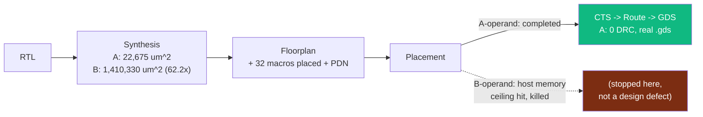

# The Mechanical Engineer's Path Through GreenCoyote-Bay

> **Who this is for:** someone who needs real dimensions, real power
> numbers (and to know which power numbers are *not* real), and an
> honest list of what physical packaging questions are still open.
>
> **Not the source of truth.** The concept-art chassis renders in
> [`gcb-spec/concepts/`](https://github.com/jagreen03/gcb-spec/tree/main/concepts) are explicitly
> labeled AI-generated illustration, not CAD — **do not use them for
> layout, thermal, or clearance work.** The real numbers below come
> from actual EDA tool output, not renders.

*What a real physical-design run actually looked like this session —
including the honestly-reported point where the larger design exceeded
the build host's own memory, not a claim of universal infeasibility.*

## Real physical numbers that exist today

This program has run actual OpenROAD place-and-route (ASAP7, an
**academic 7 nm PDK, not a commercial foundry process**) on two real
digital designs this session. Treat every number below as "what a
digital logic block looks like in a 7nm-class academic PDK," not as a
production packaging spec — there is no commercial-process, no
photonic-packaging, and no thermal-bench data anywhere in this program
yet.

| Design | Die area | Per-macro footprint | Status |
|---|---|---|---|
| Tensor A-operand | ~80,047 µm² (283 µm × 283 µm) | — | **Complete** — real `6_final.gds`/`.def`/`.spef`, 0 DRC violations |
| Tensor B-operand (64× larger operand) | ~1.41 mm² at synthesis stage (confirmed: 1,410,330 µm², a **62.2×** scale-up matching the intended 64× operand growth almost exactly) | **132.81 µm × 331.8 µm** per SRAM macro (after fixing a real aspect-ratio defect, see below) | **Placement stage killed by the build host's own memory ceiling** — a real, honestly-reported resource limit, not a design flaw |

### A real packaging lesson already learned the hard way

The first attempt at generating the B-operand's SRAM macro produced an
**8.36 µm × 5308.8 µm** shape — a ~635:1 aspect ratio, physically
absurd and rejected outright by the place-and-route tool's own
`-min_ar 0.33` sanity bound. The fix (`column_mux_factor=16` in the
memory-compiler config, a standard technique for exactly this failure
mode) produced the sane **132.81 µm × 331.8 µm** shape in the table
above. **The lesson for packaging:** a memory array's raw depth×width
ratio does not translate directly into a sane physical footprint — it
has to be explicitly reshaped, and getting this wrong produces shapes
no placer or package designer could work with.

## Power numbers — one real caveat that matters a lot

The A-operand run's report shows **87.45 W total power**, of which
**86.1 W (98.5%) is the SRAM macro group**. **This is not a real power
number to design a heatsink against.** The macros are
`FakeRAM2.0`-generated blackbox stand-ins (a standard EDA technique for
memory that hasn't been compiled by a real SRAM compiler yet) with
generic, placeholder leakage characterization — the figure is flagged
explicitly in this program's own records so it is never mistaken for a
real thermal design input. **There is currently no real power/thermal
number anywhere in this program suitable for enclosure design.**

## What a future photonic packaging question looks like

Track B's optical components (see `saga-03-photonics-prof.md`) exist
only as layout-generator scripts (`gcb-pic-core`'s `mmi_power_tree.py`,
`wdm_combiner_tree.py`, etc.) — real, valid photonic-mask-shaped
geometry, but never through a photonic foundry, never packaged, never
fiber-coupled on a bench. Questions a mechanical engineer would
eventually own here — fiber-array edge-coupler alignment tolerance,
thermo-optic drift management, hybrid electronic/photonic die
co-packaging — are all genuinely **open, unscoped, and not yet
represented anywhere in this program's real evidence base.** The
chassis/fiber-routing concept renders exist purely to give a shared
mental picture for slide decks, per their own README's explicit
warning.

## Epistemic status, stated plainly

Die area, macro footprint, and the aspect-ratio defect/fix are
`PROVEN` — real EDA tool output, independently re-verified this
session against the raw per-stage report files, not taken on faith.
Power is explicitly **not** trustworthy as a design input. Anything
about enclosures, thermal solutions, or photonic packaging beyond the
digital-logic footprint above is presently a **concept-art-only**
question this program has not yet engineered an answer to.
