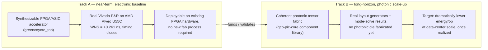

# The Investor's Path Through GreenCoyote-Bay

> **Who this is for:** someone evaluating the commercial shape of this
> program, not its circuit diagrams.
>
> **Not the source of truth, and not legal or financial advice.**
> Technical specifics are grounded in `gcb-spec`; the **licensing
> statement below is deliberately conservative** — see the flag at the
> end before repeating any specific licensing claim to a third party.

## A two-track strategy, at two different maturity levels — stated honestly

This program is building toward one long-term goal (replacing
electronic tensor-reduction with photonic interference) via two tracks
with genuinely different risk/reward profiles:

**Track A is the thing an investor can actually point to today**: a
real, synthesizable digital design with real timing-closure evidence on
a commercially available FPGA part — not a rendering, not a simulation
claim, an actual Vivado place-and-route result (see
`saga-04-electrical-eng.md` for the numbers). **Track B is the
long-horizon bet**: real component-level engineering (a verified
waveguide mode solve, real photonic layout generators, a worked-out
multiply-by-interference mechanism) with no system-level photonic
hardware built or measured yet. Presenting Track B's component-level
rigor as if it were system-level proof would overstate where the
program actually is — this page deliberately does not do that.

## What de-risks this, concretely

- **Track A doesn't require Track B to succeed to have standalone
  value** — it's a real accelerator architecture on existing FPGA
  silicon, usable on its own.
- **The register-map and host-software stack are real and exercised**
  (`saga-07-corporate.md`) — not a paper architecture; a driver, a
  simulator, and a generated five-way-consistent register map all
  exist and were independently re-verified this session.
- **The program's own discipline catches its own overclaims** — the
  repository history includes multiple documented self-corrections
  (a wrongly-claimed toolchain unavailability, a conflated parameter,
  a stale documentation claim) each found and fixed rather than left
  standing. That pattern of honest self-audit is itself a data point
  about the engineering culture, for whatever that's worth to a
  diligence process.

## ⚠ Licensing — flagged, not asserted

**Do not repeat "Apache 2.0" or any other specific open-source license
as this program's licensing model without verifying it first.** Checked
directly this session: the only `LICENSE` file found anywhere in the
program's repositories is `gcb-grants/LICENSE.md`, and it states
**"Copyright © 2026 John A. Green... All rights reserved"** — not an
open-source license. No other repository in the program (`gcb-spec`,
`gcb-rtl`, `gcb-host`, etc.) carries a license file of any kind. An
"open-source foundry" commercialization model may well be the intended
future direction, but as of this check it is **not yet the program's
documented legal reality** — that is the Architect's decision to make
and state explicitly, not something to assume into an investor deck.

## Epistemic status, stated plainly

Track A's technical claims are `PROVEN` by real tool output. Track B's
are `RTL/layout, simulated` at the component level, with no system
integration or physical measurement yet. The licensing model is
**undetermined as of this writing** — flagged above specifically so
this page is not the source of a licensing claim that turns out to be
wrong in front of an investor.
