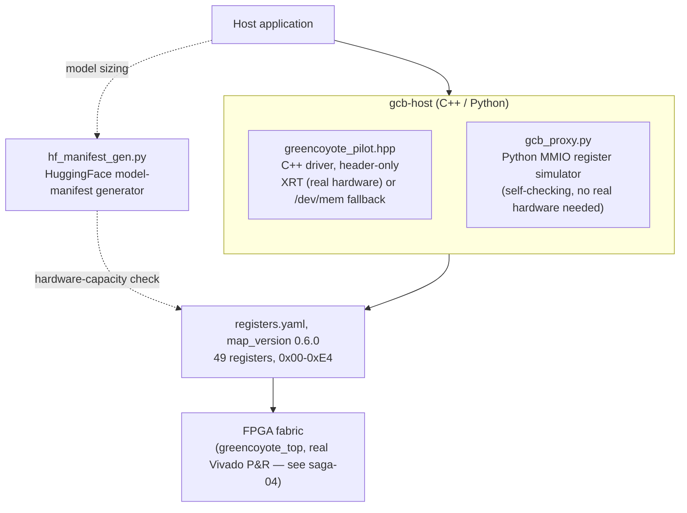

# The Corporate Contact's Path Through GreenCoyote-Bay

> **Who this is for:** someone evaluating integration effort — what API
> surface exists, what's real vs. planned, what a pilot deployment
> would actually touch.
>
> **Not the source of truth.** `gcb-spec/registers.yaml` is. Everything
> below was independently re-verified this session by reading the real
> source files, not taken from a slide.

## The host-side stack, top to bottom

## What's real, checked this session, not assumed

- **`greencoyote_pilot.hpp`** — a real, ~800-line, header-only C++ API
  (`class GreenCoyotePilot`) targeting an Alveo U55C via Xilinx Runtime
  (XRT), with an explicit `/dev/mem` mmap fallback for bare-metal/debug
  access with no XRT installed. Confirmed compiling cleanly
  (`g++ -std=c++17 -Wall`, zero warnings) against a real smoke test this
  session, including a recently-added feature (see below).
- **`gcb_proxy.py`** — despite an old, now-corrected README claim calling
  it a "FastAPI MMIO proxy," direct code inspection confirms it contains
  **zero FastAPI code**: a self-checking, pure-Python register simulator
  that exercises the real v0.6.0 register map without needing hardware
  attached — useful for integration testing before any FPGA is on hand.
- **`hf_manifest_gen.py`** — a real, separate 725-line tool: reads a
  HuggingFace model's `config.json` and produces a GreenCoyote-Bay
  hardware-resource manifest describing what this fabric would need to
  serve that model. Tested this session against synthetic configs: it
  correctly **rejects** an oversized dense model (insufficient tile
  capacity) and correctly **degrades** a model that fits with headroom
  — real negotiation logic, not a stub.
- **The register map itself** — `registers.yaml` is explicitly, in its
  own header, "THE SOURCE OF TRUTH," with `regen.py` as its only
  authorized writer into five downstream consumers (C++, Python,
  SystemVerilog, TypeScript, and a generated datasheet). All five were
  independently cross-checked this session for `map_version`, register
  count, and address-range consistency — a real, passing check, not an
  assumption.

## A real example of the maintenance model

This session found and fixed a genuine gap of exactly the kind an
integrator should expect to encounter occasionally in a program this
size: `registers.yaml` had added two new interrupt-enable bits
(`IRQ_CTRL[5]`/`[6]`) in `map_version 0.6.0`, and the hand-written RTL
register decoder *and* the C++ driver's convenience helper had both
lagged behind that addition — found via the RTL's own honest `// TODO`
comment, fixed in both places, verified by actually recompiling and
re-running the existing test regression rather than assumed correct.
That is the realistic shape of integration risk here: a well-specified,
generated-and-cross-checked register map, with occasional, honestly
flagged lag in the hand-maintained pieces that consume it.

## Epistemic status, stated plainly

The driver, simulator, and manifest tool are all `PROVEN` to at least
compile/run correctly against real inputs — not merely described. No
claim is made here about production-grade reliability, support SLAs, or
deployment at scale; this program is pre-commercial engineering, not a
shipped product.
